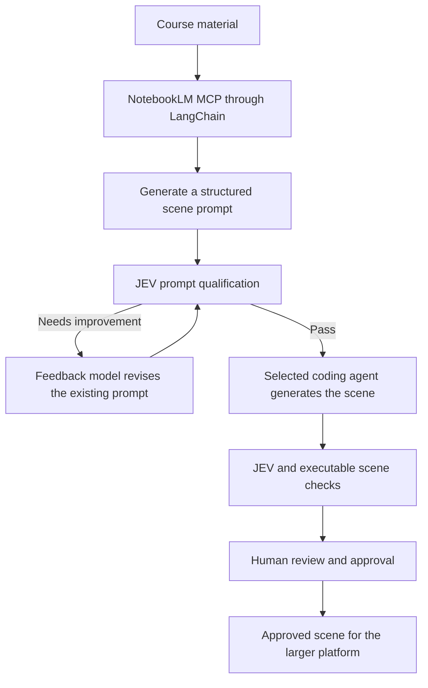

# 23. Version 3: Technologies for Processing the Core Business Feature

**Document type:** Project context and version note  
**Status:** V3 project context  
**Version:** V3 — Core Business Feature Processing Technologies  
**Parent product:** The larger interactive visual learning platform  
**Last updated:** 2026-10-01

## 1. Purpose

This document records Version 3, the technologies selected for it, and its place within the larger product. It is documentation for project context. It is not a feature specification, implementation plan, or replacement for the parent product vision and architecture documents.

## 2. Place in the Larger Product

The larger product is an educational platform that helps institutions transform course material into instructor-reviewed interactive visual learning content and deliver it through their learning systems. The broader product includes its Laravel application, future knowledge services, scene assets, review processes, and institutional integrations.

Version 3 is the **technology workflow for processing the platform's core business feature**: turning course material into instructor-reviewed interactive visual learning scenes. It is one part of the larger product, not a standalone replacement for it. The work is intended to establish a repeatable proof of concept for that business capability.

See [Project Vision](01_ProjectVision.md) and [Business Model](02_Business.md) for the parent product's vision and commercial target.

## 3. Version Context and Boundaries

| Name | Project meaning | Relationship to current work |
|---|---|---|
| **Interactive Visual Scenes V2** | The completed, full scene collection identified by the project owner as V2 (stored in the project’s `Interactive-Seens-Material/` folder). | Finished output baseline and reference. Its existing files are not being regenerated, rewritten, or modified in this workstream. |
| **Version 3 — Core Business Feature Processing Technologies** | The technology workflow for source research, prompt generation and qualification, scene generation, and review. | Active workstream. It uses the completed V2 scenes as a reference for the type and quality of output it should produce. |
| **KOS/KIE** | The broader Knowledge Operating System and Knowledge Intelligence Engine capabilities. | Separate, unfinished module track. Neither service is used as a dependency in V3. It may be developed independently or in parallel and integrated later. |

“V3” identifies this technology workstream within the larger platform. It does not mean that the complete platform is at release 3, and it does not change the meaning or status of V2.

## 4. V3 Processing Workflow

The active workflow is:



Temporal manages durable workflow progress across the stages; Laravel provides the application and management experience. These are cross-cutting management roles, not extra sequential authoring stages. Scene generation begins only after the prompt passes qualification. The generated scene is checked against that prompt and reviewed by a human before release.

## 5. Technology Direction

| Technology | Role in this workstream |
|---|---|
| **Laravel** | Existing product backend and management layer for authoring runs, status, and reviewer interaction. |
| **Temporal** | Durable workflow management for long-running generation steps, retries, and pauses for review. |
| **LangChain** | Connects language models and tools, including the NotebookLM MCP server, within the authoring workflow. |
| **NotebookLM** | Source-grounded research and retrieval environment in the V3 workflow. |
| **`m4yk3ldev/notebooklm-mcp`** | MCP connection used to let the workflow interact with NotebookLM programmatically. This is the selected V3 integration. |
| **Gemini API, GLM, and DeepSeek** | Planned language-model providers for prompt and generation tasks, routed through the model integration layer as supported by each provider. |
| **JEV by TypeSafe AI** | Qualification model used to assess generated prompts and generated scenes. A separate feedback model revises prompts that fail qualification. |
| **Coding agent** | Selected API-based or CLI coding agent that writes the scene after its prompt passes. |
| **V2 scene collection** | Completed reference for scene expectations; it is not an implementation target for modification. |

The NotebookLM MCP server is a community integration rather than a Google-owned product component. The project has selected it for the V3 workflow.

## 6. Why V3 Is Being Developed

The existing [NotebookLM-to-Google-AI-Studio workflow](22_LegacyNotebookLMGoogleAIStudioWorkflow.md) relies on manual prompt handling, scene generation, and review. Version 3 aims to automate those steps while keeping qualification and instructor review in the process.

The reasons for this change are to:

- reduce repeated manual work between course research, prompt creation, and scene generation;
- reject or improve weak prompts before spending effort generating scene code;
- make the generation process more repeatable across model providers and coding agents;
- provide qualification results and human review before a scene is released;
- demonstrate the workflow as a proof of concept for the larger education business.

The business value must be demonstrated by measuring the full cost and time to produce an approved scene, including model calls, qualification, revisions, coding-agent work, and human review.

## 7. V3 Boundaries

- NotebookLM MCP is the source and retrieval path for this workstream.
- KOS/KIE and their chunking, embedding, indexing, and retrieval services are not active V3 dependencies.
- KOS/KIE remains a separate module track and may be integrated later without blocking V3.
- The completed V2 scene files are references and are not part of current generation or modification work.
- This document records V3's place in the larger product and the technologies selected for this workstream.

## 8. Related Project Documents

- [Project Vision](01_ProjectVision.md) and [Business Model](02_Business.md) describe the parent platform and business goals.
- [System Architecture](03_SystemArchitecture.md) and [Pipeline](04_Pipeline.md) describe the wider product architecture and learning-content flow.
- [Knowledge Intelligence Specification](21_KnowledgeIntelligenceSpecification.md) describes the separate KIE module; it is not a V3 dependency.
- [Legacy NotebookLM Workflow](22_LegacyNotebookLMGoogleAIStudioWorkflow.md) records the manual process V3 aims to automate.

The Flow Charts For every Feature 

### 1\. Access and roles

```
This Mermaid diagram exceeds the terminal renderer's size limits.
flowchart TD
  A["Request a V3 action"] --> B{"Valid session?"}
  B -- No --> C["Sign in or recover account"]
  C --> D{"Identity verified and account active?"}
  D -- No --> X["Deny access; give a safe message; record attempt"]
  D -- Yes --> E["Load role and ownership scope"]
  B -- Yes --> E
  E --> F{"Requested action"}
  F -- "Upload PDF" --> G{"Teacher role?"}
  G -- Yes --> H["Allow upload entry"]
  G -- No --> X
  F -- "View or review teacher content" --> I{"Teacher is original owner?"}
  I -- Yes --> J["Allow action on own content"]
  I -- No --> X
  F -- "Manage runs or settings" --> K{"Admin role and metadata-only action?"}
  K -- Yes --> L["Allow admin action"]
  K -- No --> X
```

Permission is checked again when an action is submitted, including approval. A valid session alone never grants access to another teacher’s case. Disabling a teacher account stops access; it does not transfer that teacher’s reviews.

### 2\. PDF submission and processing case

This flow uses three different identities: an **upload attempt ID** for every attempt, an opaque **document ID** for an accepted source, and a **processing case ID** for each run. The accepted document ID is linked internally to a SHA-256 hash of the exact uploaded bytes. It should not be the hash itself.

```
This Mermaid diagram exceeds the terminal renderer's size limits.
flowchart TD
  A["Teacher submits a file"] --> B["Check upload permission; assign upload attempt ID"]
  B --> C["Receive into private staging area; enforce size and complete transfer"]
  C --> D{"Empty, interrupted, or over limit?"}
  D -- Yes --> R["Reject attempt; clean staging; show reason; create no case"]
  D -- No --> E{"Filename has allowed .pdf extension?"}
  E -- No --> R
  E -- Yes --> F["Inspect actual bytes and parse PDF structure"]
  F --> G{"Valid PDF with at least one page?"}
  G -- No --> R
  G -- Yes --> H{"Encrypted or contains unsupported active or embedded content?"}
  H -- Yes --> R
  H -- No --> I["Run malware and dangerous-content checks"]
  I --> J{"Check result"}
  J -- Unsafe --> R
  J -- Unavailable --> Q["Keep isolated; retry check or alert admin; create no case"]
  J -- Safe --> K["Calculate SHA-256 of accepted bytes"]
  K --> L{"Same teacher already has this exact hash?"}
  L -- Yes --> M["Show that teacher's previous case"]
  M -- "Open previous" --> N["Open existing case; create no new run"]
  M -- "Process again" --> O["Use existing private document ID"]
  L -- No --> P["Prepare new opaque document ID and private source record"]
  O --> S["Record a new processing case and its settings version"]
  P --> S
  S --> T{"Document and case recorded successfully?"}
  T -- No --> U["Mark attempt failed; recover or clean staged source"]
  T -- Yes --> V["Request background processing"]
  V --> W{"Processing request accepted?"}
  W -- No --> Y["Keep case delayed; retry handoff and show status"]
  W -- Yes --> Z["Show queued case in teacher dashboard"]
```

A file renamed from `.exe` to `.pdf` fails the byte and PDF parsing checks. The browser’s MIME label is recorded as a clue, never treated as proof. A scanned PDF can pass file validation; whether its educational content can be read is decided in feature 4. If another teacher uploads identical bytes, that teacher receives a separate private document and case, with no notice about anyone else’s upload. A changed byte produces a different hash.

A PDF’s embedded `/ID` describes document identity across PDF revisions, so it is unsuitable for exact byte comparison. The generated document ID and byte hash serve different purposes. [PDF Association: file identifiers](<https://pdf-issues.pdfa.org/32000-2-2020/clause14.html>). The layered upload checks follow [OWASP’s file upload guidance](<https://cheatsheetseries.owasp.org/cheatsheets/File_Upload_Cheat_Sheet.html>).

### 3\. Progress visibility

```
This Mermaid diagram exceeds the terminal renderer's size limits.
flowchart TD
  A["Teacher opens dashboard or a case"] --> B{"Owns the case?"}
  B -- No --> X["Return unavailable; reveal nothing about another teacher"]
  B -- Yes --> C["Read recorded case stage and scene states"]
  C --> D{"Learning units identified yet?"}
  D -- No --> E["Show current PDF processing stage and last update"]
  D -- Yes --> F["Show each scene and counts by state"]
  E --> G{"Current outcome"}
  F --> G
  G -- Processing --> H["Show actual stage and last update"]
  G -- Waiting for teacher --> I["Show review action and in-app alert"]
  G -- Dormant review --> J["Alert original teacher upon next login"]
  G -- Some complete, others pending --> K["Show partial progress and required actions"]
  G -- All approved --> L["Show completed case and approved scenes"]
  G -- Blocked or cancelled --> M["Show safe reason and available next action"]
  H --> N{"Progress overdue?"}
  N -- Yes --> O["Show delayed state; alert admin using metadata"]
  N -- No --> P["Refresh when a recorded state changes"]
```

The PDF has an overall status; each resulting scene has its own status. The dashboard shows recorded stages and counts rather than inventing a percentage before the number of scenes is known. Admins can inspect the same operational states across cases without opening content.

### 4\. Prompt generation and JEV qualification

This flow runs **per learning unit**. Its output is either a qualified prompt version or a blocked unit. The teacher does not approve or edit prompts.

```
This Mermaid diagram exceeds the terminal renderer's size limits.
flowchart TD
  A["Accepted case with private PDF source"] --> B["Make source available to NotebookLM processing"]
  B --> C{"Source service available?"}
  C -- No --> D["Retry within policy; then flag blocked unit for admin"]
  C -- Yes --> E["Find source-grounded learning units"]
  E --> F{"Readable educational content and at least one unit?"}
  F -- No --> G["Block source processing; ask teacher for a readable PDF"]
  F -- Yes --> H["Create a draft prompt with source references for each unit"]
  H --> I{"Proposed tool action stays within this job?"}
  I -- No --> J["Block action; record policy failure; alert admin"]
  I -- Yes --> K["Submit draft to JEV"]
  K --> L{"JEV returned a usable verdict?"}
  L -- No --> M["Retry qualification; then block if service remains unavailable"]
  L -- Yes --> N{"Prompt meets active criteria and threshold?"}
  N -- Yes --> O["Record qualified prompt version for scene generation"]
  N -- No --> P["Use findings to revise this same prompt"]
  P --> Q{"Revision attempts remain?"}
  Q -- Yes --> K
  Q -- No --> R["Block this unit; show operational failure to admin"]
```

The PDF and retrieved text are **source data**, including any text that looks like an instruction to the AI. A document cannot authorize extra tool actions or change the system’s task. This matters because instructions can be hidden in documents used by an AI workflow. [OWASP: LLM Prompt Injection Prevention](<https://cheatsheetseries.owasp.org/cheatsheets/LLM_Prompt_Injection_Prevention_Cheat_Sheet.html>).

One blocked learning unit should be visible as blocked while other qualified units can continue. The PDF status then shows partial progress.

### 5\. Scene generation and automated qualification

```
This Mermaid diagram exceeds the terminal renderer's size limits.
flowchart TD
  A["Qualified prompt and recorded settings version"] --> B["Coding agent generates a scene version"]
  B --> C{"Provider returned a usable artifact?"}
  C -- No --> D["Retry provider failure within policy"]
  D --> E{"Recovered?"}
  E -- No --> X["Block unit; escalate operational metadata to admin"]
  E -- Yes --> B
  C -- Yes --> F["Check artifact structure and disallowed behavior"]
  F --> G{"Unsafe code, forbidden access, or incomplete HTML?"}
  G -- Yes --> R["Send findings to coding agent to correct this scene"]
  G -- No --> H["Run scene in isolated preview and exercise its functions"]
  H --> I{"Render and interactions work?"}
  I -- No --> R
  I -- Yes --> J["JEV compares scene with qualified prompt and source requirements"]
  J --> K{"Usable JEV verdict and qualification pass?"}
  K -- No --> R
  K -- Yes --> L["Record checked scene version; create teacher review item"]
  R --> M{"Correction attempts remain?"}
  M -- Yes --> F
  M -- No --> X
```

Generated HTML remains isolated while it is checked and previewed. A JEV pass cannot compensate for a broken or unsafe executable scene; both checks must pass before teacher review. OWASP recommends sandboxed frames for untrusted browser content. [OWASP: HTML5 Security](<https://cheatsheetseries.owasp.org/cheatsheets/HTML5_Security_Cheat_Sheet.html>).

### 6\. Original teacher review and revisions

The pending review is a durable item. Waiting for the teacher does not keep a generation worker occupied.

```
This Mermaid diagram exceeds the terminal renderer's size limits.
flowchart TD
  A["Checked scene becomes ready"] --> B["Create pending review for original uploading teacher"]
  B --> C{"Original teacher opens review?"}
  C -- No --> D{"Dormancy threshold reached?"}
  D -- No --> B
  D -- Yes --> E["Mark dormant; admin sees metadata and may remind"]
  E --> F{"Original teacher returns?"}
  F -- Yes --> G["Show in-app alert and open review"]
  F -- No --> H{"Admin cancels abandoned run?"}
  H -- No --> E
  H -- Yes --> X["Cancel run; retain history; no approval"]
  C -- Yes --> G
  G --> I{"Isolated scene preview works?"}
  I -- No --> J["Return scene for correction; keep teacher review pending"]
  I -- Yes --> K{"Teacher's decision"}
  K -- No decision --> B
  K -- Approve --> L{"Still the current scene version?"}
  L -- No --> G
  L -- Yes --> M["Record teacher and version approval; save approved scene"]
  K -- Request changes --> N{"Usable notes supplied?"}
  N -- No --> G
  N -- Yes --> O{"Notes identify a factual or source interpretation error?"}
  O -- No --> P["Regenerate scene with existing qualified prompt and notes"]
  O -- Yes --> Q["Revise prompt from source; run JEV prompt qualification again; regenerate"]
  P --> R["Run scene qualification again; return new version to same teacher"]
  Q --> R
  R --> B
```

A factual error is the exception to the usual scene revision route. The teacher still reviews only the finished scene; the system reopens prompt qualification internally. No admin or other teacher can take over the educational decision. If the teacher later requests a correction to an approved scene, that begins a new version while the earlier approval remains in its history.

### 7\. Admin management and operations

```
This Mermaid diagram exceeds the terminal renderer's size limits.
flowchart TD
  A["Admin opens management area"] --> B{"Authorized Admin?"}
  B -- No --> X["Deny and record attempt"]
  B -- Yes --> C{"Admin action"}
  C -- Teacher accounts --> D["Create, update, or deactivate account"]
  D --> E{"Existing account or active pending reviews?"}
  E -- Existing --> F["Show account conflict or update existing record"]
  E -- Pending reviews --> G["Keep reviews with original teacher; mark dormant if inaccessible"]
  E -- Neither --> H["Save account change and audit it"]
  C -- Generation settings --> I["Draft provider, model, template, or JEV rule change"]
  I --> J{"Valid and available?"}
  J -- No --> K["Reject change; keep previous active settings"]
  J -- Yes --> L["Activate new settings version for later runs; audit change"]
  C -- Run monitoring --> M["Show statuses, failures, timings, and costs only"]
  M --> N{"Run needs intervention?"}
  N -- Failure or delay --> O["Retry or cancel; record reason and outcome"]
  N -- Dormant teacher review --> P["Record reminder or cancel abandoned run"]
  N -- No --> Q["Continue monitoring"]
  C -- Open teacher content or approve scene --> X
```

The admin can manage providers, prompt templates, JEV criteria, thresholds, accounts, and operational runs. Existing runs retain the settings version recorded when they began; a settings change does not silently change an in-progress qualification. A disabled teacher’s review stays with that teacher until they return or the run is cancelled.

### 8\. History and business evidence

```
This Mermaid diagram exceeds the terminal renderer's size limits.
flowchart TD
  A["Upload, processing, setting, scene, or review event"] --> B["Link event to its case and relevant document or version"]
  B --> C["Record actor or system, time, decision, reason, and settings version"]
  C --> D{"Required history recorded?"}
  D -- No --> E["Do not report the state change as completed; flag operational failure"]
  D -- Yes --> F["Update case and scene timelines"]
  F --> G["Derive duration, attempts, outcomes, and provider usage"]
  G --> H{"Cost or usage data missing?"}
  H -- Yes --> I["Display unknown or partial estimate, never zero by assumption"]
  H -- No --> J["Display measured or estimated cost with its basis"]
  I --> K{"Who requests the history?"}
  J --> K
  K -- Owning teacher --> L["Show own source, scene versions, notes, and approvals"]
  K -- Admin --> M["Show operational metrics without teacher content"]
  K -- Another teacher --> N["Deny without revealing that the case exists"]
```

This gives the business an answer to “how did this scene become approved?” and “what did an approved scene cost in time and processing?” Approval and previous scene versions remain traceable after later revisions.

The values for file size, dormancy time, correction limits, and JEV thresholds remain **configurable decisions for the later specifications**. These charts establish what happens on either side of each decision. The next stage in your sequence is to compare these eight flows with the existing Laravel, Python, and project materials, then identify reuse, replacement, and missing work before defining specs.


