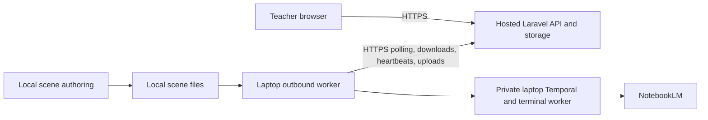

# Hosted Laravel ↔ outbound laptop worker

The actual Laravel installation now has an enrolled laptop worker. This is separate from the disposable workflow tests. The current origin is `http://127.0.0.1:8766`; this is the local deployment address, not a public hosted deployment.

## Network protocol

The laptop initiates requests to `/api/v3/local-worker/v1` on the configured Laravel origin. Remote origins require HTTPS with normal certificate verification. HTTP is accepted only for loopback development addresses. Credentials in URLs, origin paths, queries and fragments are rejected. HTTP redirects are not followed by the worker client.

A platform-owner pairing invitation grants an expiring device token. The laptop keeps its token in a mode-0600 local config; Laravel stores its hash and supports owner revocation/rotation. The worker polls for assignments, downloads manifests/PDF bytes by opaque IDs, sends lease heartbeats, and uploads artifacts and result manifests over the same authenticated API. Assignment IDs/epochs fence stale results; SHA-256 binds downloaded and uploaded bytes to their captured identities.

A teacher's **Pull Generated Scenes** action creates queued return work. The outbound worker collects it. Laravel never needs to initiate a connection to the laptop. No laptop port forwarding, public laptop IP, shared drive, SSH access, or Laravel database access is part of this protocol.



## Configured laptop runtime

The laptop runs three enabled user services:

- `eduplatform-local-temporal.service`: private Temporal, `127.0.0.1:7234`, namespace `v3-local-worker`, durable local database.
- `eduplatform-local-terminal.service`: the existing terminal workflow worker.
- `eduplatform-local-worker.service`: the production outbound daemon, paired to Laravel.

These services restart on failure. User lingering is enabled on this device so logout does not stop them; the laptop still needs power, connectivity, and its local session. The standalone runtime has its own workspace and Temporal state under `~/.local_worker`, separate from the product Docker stack and older local runs.

`~/.local_worker/config.json` contains the configured server origin, device token, workspace and local terminal settings path. `runtime.json` contains local runtime paths and the private Temporal address. Neither file should be published. The existing NotebookLM session stays at its original local path; it was not uploaded or duplicated into Laravel. The local terminal template contains only the existing provider/model/account-proof settings used for prompt export.

The supervised services set `V3_TERMINAL_LOAD_PROJECT_ENV=0`. The terminal entrypoint, outbound entrypoint, and engine settings honor it. Their environment omits Laravel `APP_*`/`DB_*` values, bridge/callback HMACs and paid generation keys. A separate hosted Laravel checkout may therefore have completely different directories and server secrets. The normal same-host mode retains its existing default environment behavior.

Commands, from the laptop's code checkout:

```bash
./bin/local-worker-runtime status
./bin/local-worker-runtime stop   # drains the outbound daemon, then stops local workers/Temporal
./bin/local-worker-runtime start
journalctl --user -u eduplatform-local-worker.service -f
```

Reproduce installation after normal device enrollment:

```bash
./bin/local-worker enroll --server https://YOUR-HOSTED-ORIGIN \
  --terminal-manifest /absolute/local/path/to/terminal-template.json
./bin/local-worker-runtime install \
  --session /absolute/local/path/to/existing-notebooklm-session.json
./bin/local-worker-runtime start
```

Pairing entry is masked. Do not put the pairing secret into shell history using `--pairing-code`.

## When Laravel moves to hosting

1. Deploy Laravel, its own database/private PDF storage, scheduler/queue, scanner and PDF-preparation service on the server. Keep its internal bridge, database and Temporal endpoints private. The current combined Docker setup also supports the separate same-host mode; it does not need to be shared with the laptop.
2. Expose Laravel through the deployment's HTTPS domain, forwarding normal API requests and Authorization headers, and set the correct Laravel URL/proxy/upload configuration there. No public domain or TLS deployment was performed in this integration.
3. Drain the laptop runtime before changing its server identity. Keep the existing private config/workspace as a protected backup. For a new platform deployment, create a new pairing invitation on that platform and enroll the laptop against its HTTPS origin. Preserve existing pending jobs/checkpoints for their original platform instead of resetting or disguising them as new work.
4. Start the laptop runtime and run `status`. It must authenticate against the deployed origin before accepting teacher uploads there. A localhost pairing alone does not prove connectivity to a future public host.

For normal operation, teachers select **Local Worker / Prompts & Scenes** when uploading. Prompt processing and transfer are automatic. Scene authoring remains a separate local action, followed by teacher Pull. Qualification, review and publication remain separate from successful file transfer.

## Verification

- The real server accepted device enrollment; authenticated device health returned HTTP 200.
- All three local services run, with real control/IO/build Temporal pollers registered.
- An actual stop/drain/start preserved enrollment and returned the daemon to running.
- Running terminal/daemon process environments were inspected by key name: no Laravel application/database secrets, callback/bridge keys or paid generation key were present.
- Local-worker suite: **66 passed, 1 explicitly gated live-provider test skipped**. Includes actual verified TLS/Bearer exchange, rejection of an untrusted certificate, insecure remote-origin rejection, environment isolation and real PHP HTTP boundaries.
- Terminal/local-env regression: **121 passed, 22 gated/resource tests skipped**. Existing Python `import_mode` configuration warning remains.
- The complete four-stage replay/placeholder workflow also passed with both laptop subprocesses using the standalone runtime environment: no Laravel dotenv, server secrets, or paid keys. Fresh hosted test run `8ece04fb-b84f-4f9e-8f3d-902432f8ddfd` produced 61 lesson work items, 96 ordered exact prompts, and 96 exact uploaded HTML placeholders. Evidence: `storage/app/private/v3/local-worker-verification/watcher-remote-runtime-01/verification.json`. These results are isolated from the actual enrolled product worker.
- Private operational receipt: `~/.local_worker/integration-verification.json` (no device token).

No provider request, paid scene generation, or new educational PDF processing was performed against the actual product during enrollment/restart verification. Provider-session structure was checked; live NotebookLM availability was not revalidated. The previous full replay/placeholder checks remain documented in [the watcher report](FEATURE-021-WATCHER-TEST.md).
