# Implementation file atlas

Every leaf is an actual repository-relative filename. Each file is assigned to one service owner; the service-to-file grouping is curated for key boundaries and inferred for secondary files. These are smaller views of the complete second diagram in `02-all-files.mmd`.

### . · Runtime, dependencies and deployment

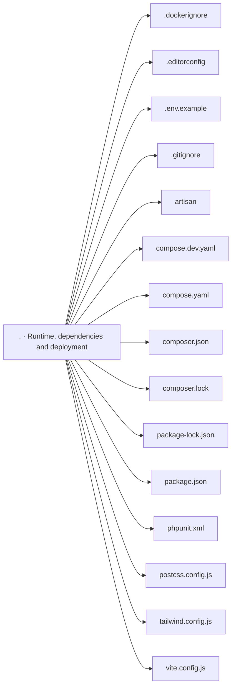

### app/Console/Commands/V3 · Shared application and engine support

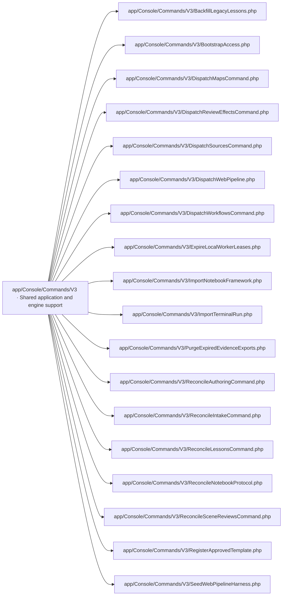

### app/Contracts/V3 · Shared application and engine support

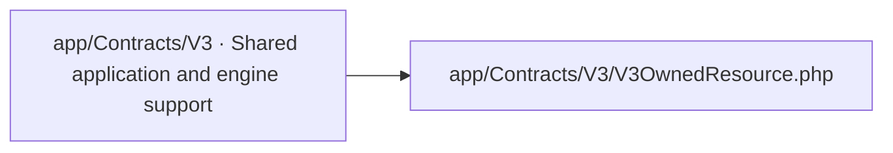

### app/Data/V3 · Shared application and engine support

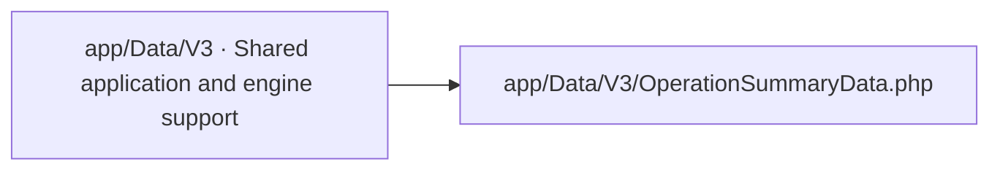

### app/Http/Controllers · Application controllers and learning content

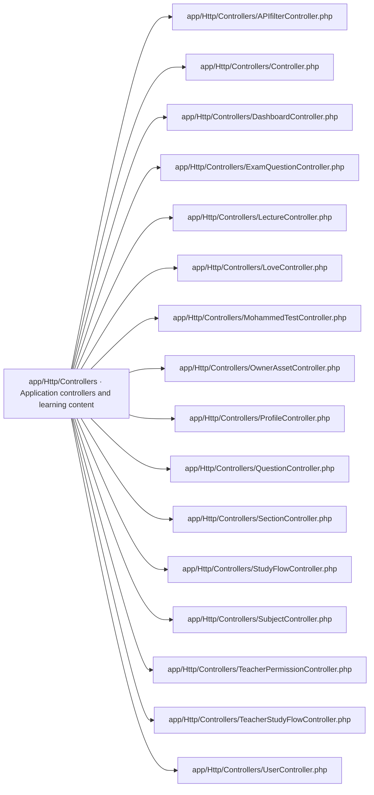

### app/Http/Controllers/Auth · Account authentication

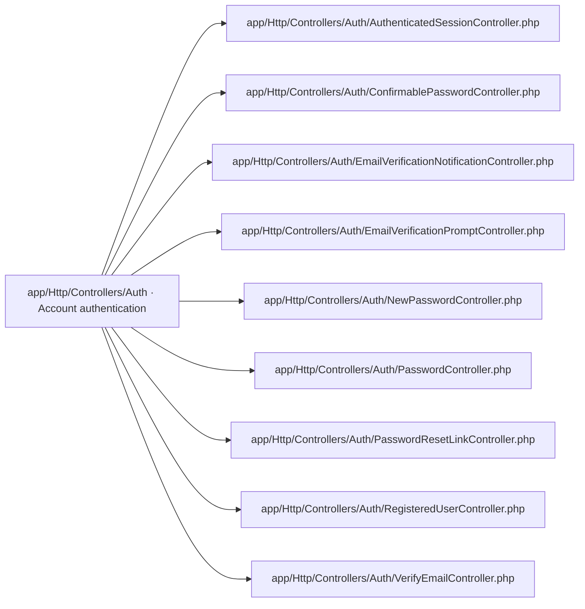

### app/Http/Controllers/V3 · Application controllers and learning content

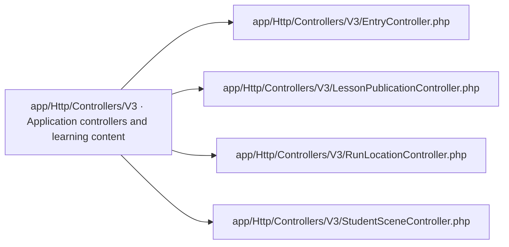

### app/Http/Controllers/V3/Admin · Administration and operations

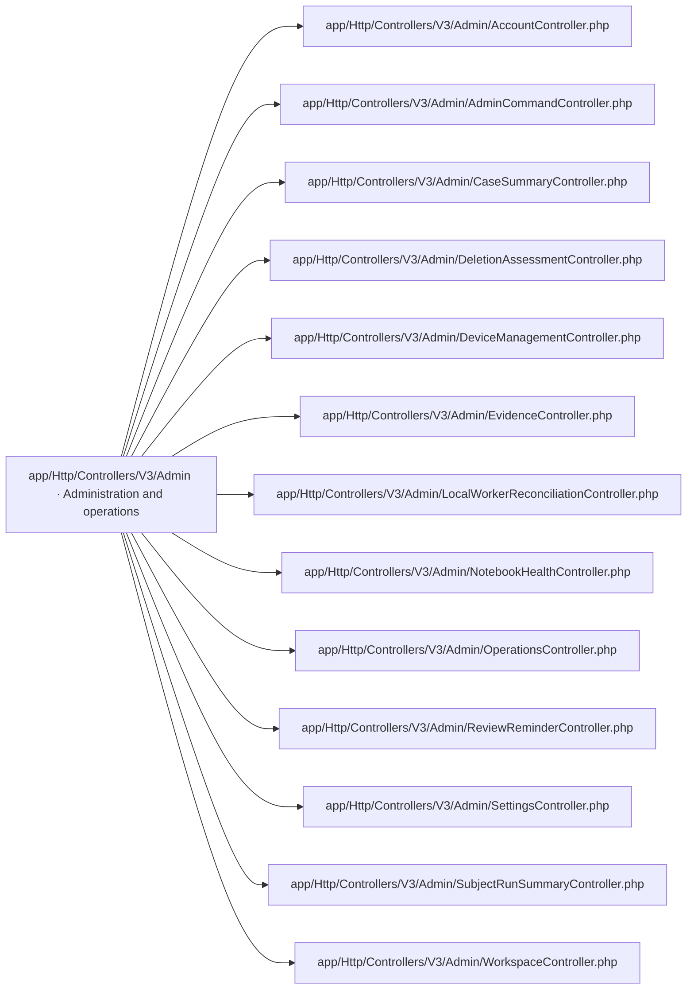

### app/Http/Controllers/V3/Internal · Application controllers and learning content

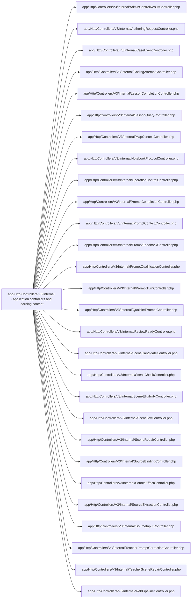

### app/Http/Controllers/V3/LocalWorker · Device registry, assignment and fencing

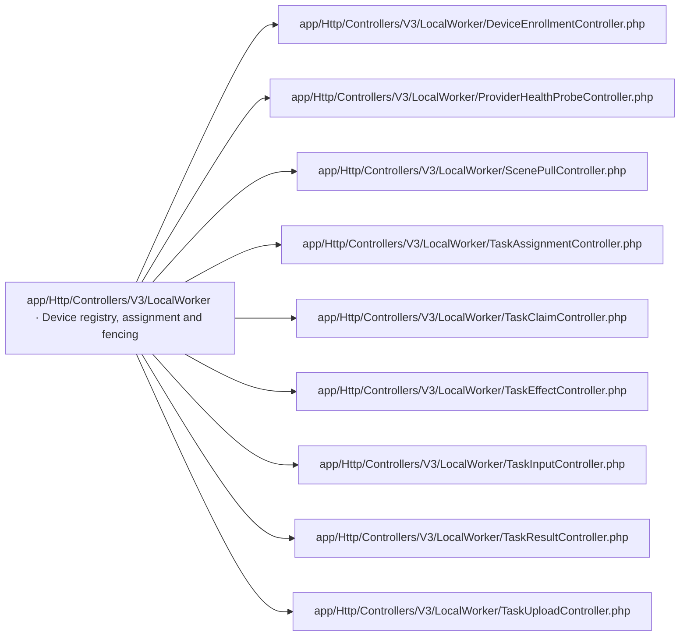

### app/Http/Controllers/V3/Teacher · Application controllers and learning content

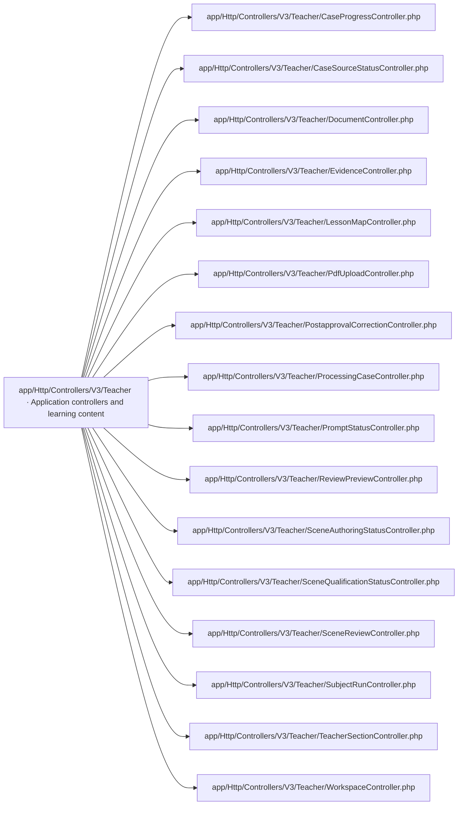

### app/Http/Middleware · HTTP routing and access boundaries

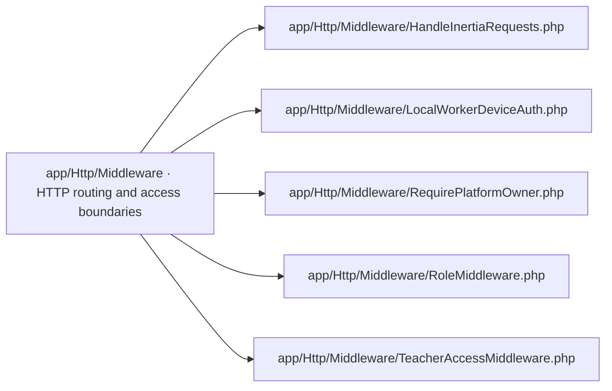

### app/Http/Middleware/V3 · HTTP routing and access boundaries

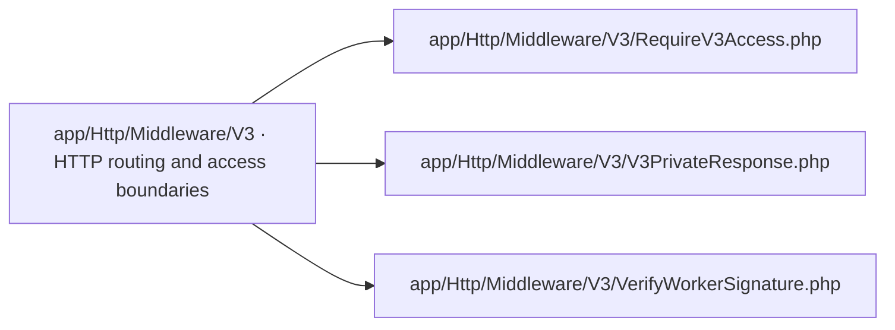

### app/Http/Requests · Shared application and engine support

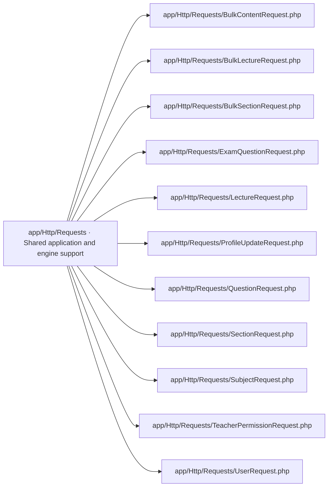

### app/Http/Requests/Auth · Account authentication


### app/Http/Requests/V3 · Shared application and engine support

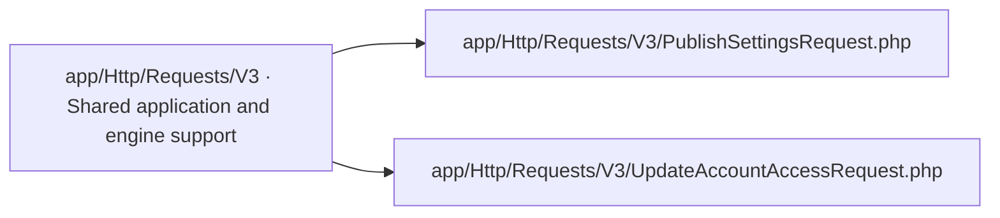

### app/Http/Resources · Shared application and engine support

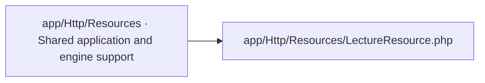

### app/Http/Resources/V3 · Shared application and engine support

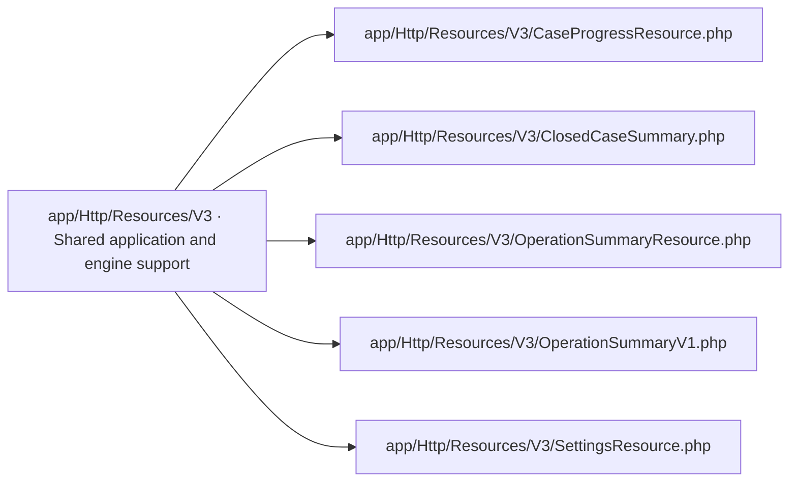

### app/Jobs/V3 · Shared application and engine support

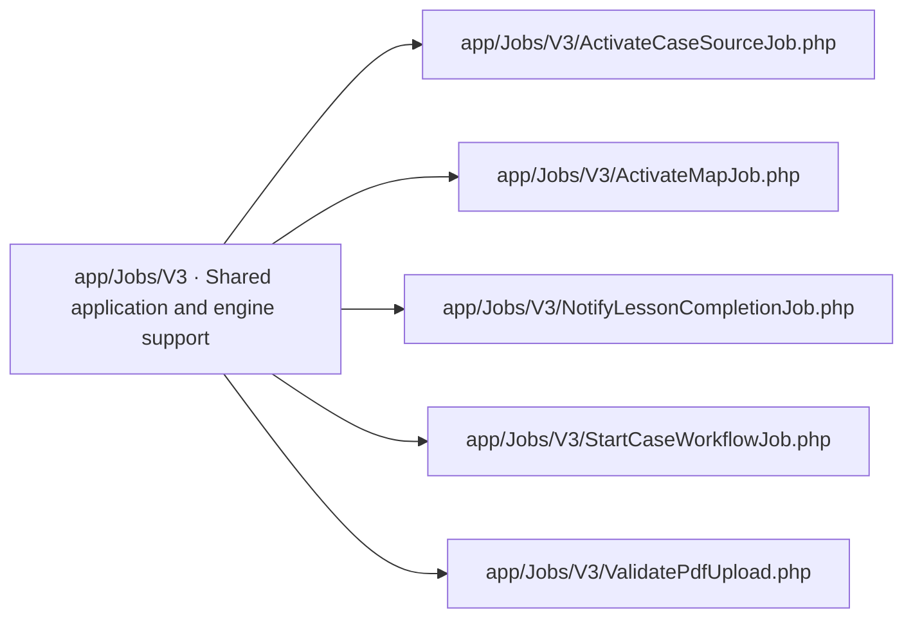

### app/Models · Persistence, configuration and framework bootstrap

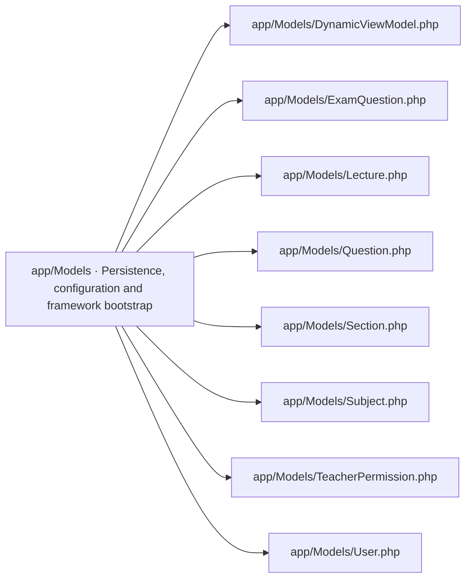

### app/Models/Concerns · Persistence, configuration and framework bootstrap

```mermaid
flowchart LR
  g20["app/Models/Concerns · Persistence, configuration and framework bootstrap"]
  f20_0["app/Models/Concerns/HasV3Owner.php"]
  g20 --> f20_0
```

### app/Models/V3 · Persistence, configuration and framework bootstrap

```mermaid
flowchart LR
  g21["app/Models/V3 · Persistence, configuration and framework bootstrap"]
  f21_0["app/Models/V3/ActiveSettings.php"]
  g21 --> f21_0
  f21_1["app/Models/V3/AdminCommand.php"]
  g21 --> f21_1
  f21_2["app/Models/V3/AdminCommandDelivery.php"]
  g21 --> f21_2
  f21_3["app/Models/V3/AdminOperationAudit.php"]
  g21 --> f21_3
  f21_4["app/Models/V3/ApprovedScene.php"]
  g21 --> f21_4
  f21_5["app/Models/V3/ApprovedTemplate.php"]
  g21 --> f21_5
  f21_6["app/Models/V3/AuthoringRequest.php"]
  g21 --> f21_6
  f21_7["app/Models/V3/CaseEvent.php"]
  g21 --> f21_7
  f21_8["app/Models/V3/CaseOperationControl.php"]
  g21 --> f21_8
  f21_9["app/Models/V3/CodingAttempt.php"]
  g21 --> f21_9
  f21_10["app/Models/V3/DeletionAssessment.php"]
  g21 --> f21_10
  f21_11["app/Models/V3/DevicePairing.php"]
  g21 --> f21_11
  f21_12["app/Models/V3/Document.php"]
  g21 --> f21_12
  f21_13["app/Models/V3/EvidenceExport.php"]
  g21 --> f21_13
  f21_14["app/Models/V3/EvidenceExportAudit.php"]
  g21 --> f21_14
  f21_15["app/Models/V3/ExtractedSource.php"]
  g21 --> f21_15
  f21_16["app/Models/V3/KnowledgeSourceBinding.php"]
  g21 --> f21_16
  f21_17["app/Models/V3/KnowledgeSourceFile.php"]
  g21 --> f21_17
  f21_18["app/Models/V3/LecturePipelineLink.php"]
  g21 --> f21_18
  f21_19["app/Models/V3/LessonCompletion.php"]
  g21 --> f21_19
  f21_20["app/Models/V3/LessonCursor.php"]
  g21 --> f21_20
  f21_21["app/Models/V3/LessonMap.php"]
  g21 --> f21_21
  f21_22["app/Models/V3/LessonNode.php"]
  g21 --> f21_22
  f21_23["app/Models/V3/LessonQuery.php"]
  g21 --> f21_23
  f21_24["app/Models/V3/LocalArtifact.php"]
  g21 --> f21_24
  f21_25["app/Models/V3/LocalAssignment.php"]
  g21 --> f21_25
  f21_26["app/Models/V3/LocalEffectAttempt.php"]
  g21 --> f21_26
  f21_27["app/Models/V3/LocalJob.php"]
  g21 --> f21_27
  f21_28["app/Models/V3/LocalProviderEffect.php"]
  g21 --> f21_28
  f21_29["app/Models/V3/LocalResult.php"]
  g21 --> f21_29
  f21_30["app/Models/V3/LocalSceneSubmission.php"]
  g21 --> f21_30
  f21_31["app/Models/V3/LocalTask.php"]
  g21 --> f21_31
  f21_32["app/Models/V3/ManualSceneImport.php"]
  g21 --> f21_32
  f21_33["app/Models/V3/MapActivation.php"]
  g21 --> f21_33
  f21_34["app/Models/V3/NotebookFrameworkVersion.php"]
  g21 --> f21_34
  f21_35["app/Models/V3/NotebookInstance.php"]
  g21 --> f21_35
  f21_36["app/Models/V3/NotebookLessonBundle.php"]
  g21 --> f21_36
  f21_37["app/Models/V3/PipelineCommand.php"]
  g21 --> f21_37
  f21_38["app/Models/V3/PipelineEvent.php"]
  g21 --> f21_38
  f21_39["app/Models/V3/PipelineOperation.php"]
  g21 --> f21_39
  f21_40["app/Models/V3/PipelineOutbox.php"]
  g21 --> f21_40
  f21_41["app/Models/V3/PostapprovalCorrection.php"]
  g21 --> f21_41
  f21_42["app/Models/V3/ProcessingCase.php"]
  g21 --> f21_42
  f21_43["app/Models/V3/ProcessingDevice.php"]
  g21 --> f21_43
  f21_44["app/Models/V3/PromptFeedbackEffect.php"]
  g21 --> f21_44
  f21_45["app/Models/V3/PromptJevAttempt.php"]
  g21 --> f21_45
  f21_46["app/Models/V3/PromptQualification.php"]
  g21 --> f21_46
  f21_47["app/Models/V3/PromptSectionState.php"]
  g21 --> f21_47
  f21_48["app/Models/V3/PromptTurn.php"]
  g21 --> f21_48
  f21_49["app/Models/V3/PromptWorkItem.php"]
  g21 --> f21_49
  f21_50["app/Models/V3/QualificationGate.php"]
  g21 --> f21_50
  f21_51["app/Models/V3/ReviewOutbox.php"]
  g21 --> f21_51
  f21_52["app/Models/V3/ReviewPreviewSession.php"]
  g21 --> f21_52
  f21_53["app/Models/V3/ReviewReminder.php"]
  g21 --> f21_53
  f21_54["app/Models/V3/ReviewRoute.php"]
  g21 --> f21_54
  f21_55["app/Models/V3/ReviewSectionState.php"]
  g21 --> f21_55
  f21_56["app/Models/V3/SceneCandidate.php"]
  g21 --> f21_56
  f21_57["app/Models/V3/SceneCandidateState.php"]
  g21 --> f21_57
  f21_58["app/Models/V3/SceneCheckAttempt.php"]
  g21 --> f21_58
  f21_59["app/Models/V3/SceneCheckRun.php"]
  g21 --> f21_59
  f21_60["app/Models/V3/SceneJevAttempt.php"]
  g21 --> f21_60
  f21_61["app/Models/V3/ScenePromptVersion.php"]
  g21 --> f21_61
  f21_62["app/Models/V3/SceneQualification.php"]
  g21 --> f21_62
  f21_63["app/Models/V3/SceneRepair.php"]
  g21 --> f21_63
  f21_64["app/Models/V3/SectionPipelineLink.php"]
  g21 --> f21_64
  f21_65["app/Models/V3/SettingsPublication.php"]
  g21 --> f21_65
  f21_66["app/Models/V3/SettingsVersion.php"]
  g21 --> f21_66
  f21_67["app/Models/V3/SourceActivation.php"]
  g21 --> f21_67
  f21_68["app/Models/V3/SourceEffect.php"]
  g21 --> f21_68
  f21_69["app/Models/V3/SubjectRun.php"]
  g21 --> f21_69
  f21_70["app/Models/V3/SubjectRunItem.php"]
  g21 --> f21_70
  f21_71["app/Models/V3/TeacherPromptCorrection.php"]
  g21 --> f21_71
  f21_72["app/Models/V3/TeacherReviewDecision.php"]
  g21 --> f21_72
  f21_73["app/Models/V3/TeacherReviewItem.php"]
  g21 --> f21_73
  f21_74["app/Models/V3/TeacherSection.php"]
  g21 --> f21_74
  f21_75["app/Models/V3/TerminalImport.php"]
  g21 --> f21_75
  f21_76["app/Models/V3/TerminalImportItem.php"]
  g21 --> f21_76
  f21_77["app/Models/V3/UploadAttempt.php"]
  g21 --> f21_77
  f21_78["app/Models/V3/V3AccessEvent.php"]
  g21 --> f21_78
  f21_79["app/Models/V3/V3AccountAccess.php"]
  g21 --> f21_79
  f21_80["app/Models/V3/WorkflowLink.php"]
  g21 --> f21_80
```

### app/Policies/V3 · Shared application and engine support

```mermaid
flowchart LR
  g22["app/Policies/V3 · Shared application and engine support"]
  f22_0["app/Policies/V3/DocumentPolicy.php"]
  g22 --> f22_0
  f22_1["app/Policies/V3/ProcessingCasePolicy.php"]
  g22 --> f22_1
  f22_2["app/Policies/V3/TeacherResourcePolicy.php"]
  g22 --> f22_2
  f22_3["app/Policies/V3/UploadAttemptPolicy.php"]
  g22 --> f22_3
```

### app/Providers · Shared application and engine support

```mermaid
flowchart LR
  g23["app/Providers · Shared application and engine support"]
  f23_0["app/Providers/AppServiceProvider.php"]
  g23 --> f23_0
```

### app/Services · Shared application and engine support

```mermaid
flowchart LR
  g24["app/Services · Shared application and engine support"]
  f24_0["app/Services/LearningAccess.php"]
  g24 --> f24_0
```

### app/Services/V3/Access · Access and identity

```mermaid
flowchart LR
  g25["app/Services/V3/Access · Access and identity"]
  f25_0["app/Services/V3/Access/AccessAuditRecorder.php"]
  g25 --> f25_0
  f25_1["app/Services/V3/Access/ChangeAccountAccess.php"]
  g25 --> f25_1
  f25_2["app/Services/V3/Access/RetainV3Account.php"]
  g25 --> f25_2
  f25_3["app/Services/V3/Access/V3AccessResolver.php"]
  g25 --> f25_3
```

### app/Services/V3/Admin · Administration and operations

```mermaid
flowchart LR
  g26["app/Services/V3/Admin · Administration and operations"]
  f26_0["app/Services/V3/Admin/AssessDeletion.php"]
  g26 --> f26_0
  f26_1["app/Services/V3/Admin/CaseOperationGuard.php"]
  g26 --> f26_1
  f26_2["app/Services/V3/Admin/DispatchAdminCommands.php"]
  g26 --> f26_2
  f26_3["app/Services/V3/Admin/PostReviewReminder.php"]
  g26 --> f26_3
  f26_4["app/Services/V3/Admin/ProbeOperationsHealth.php"]
  g26 --> f26_4
  f26_5["app/Services/V3/Admin/QueryOperations.php"]
  g26 --> f26_5
  f26_6["app/Services/V3/Admin/ReconcileAdminTarget.php"]
  g26 --> f26_6
  f26_7["app/Services/V3/Admin/SubmitAdminCommand.php"]
  g26 --> f26_7
```

### app/Services/V3/Authoring · Scene authoring and generation

```mermaid
flowchart LR
  g27["app/Services/V3/Authoring · Scene authoring and generation"]
  f27_0["app/Services/V3/Authoring/AuthoringConflictException.php"]
  g27 --> f27_0
  f27_1["app/Services/V3/Authoring/AuthoringStatusProjector.php"]
  g27 --> f27_1
  f27_2["app/Services/V3/Authoring/AuthoringTemplateUnavailableException.php"]
  g27 --> f27_2
  f27_3["app/Services/V3/Authoring/AuthoringUnavailableException.php"]
  g27 --> f27_3
  f27_4["app/Services/V3/Authoring/AuthoringValidationException.php"]
  g27 --> f27_4
  f27_5["app/Services/V3/Authoring/ClaimAuthoringRequest.php"]
  g27 --> f27_5
  f27_6["app/Services/V3/Authoring/ClaimCodingAttempt.php"]
  g27 --> f27_6
  f27_7["app/Services/V3/Authoring/ImportManualScene.php"]
  g27 --> f27_7
  f27_8["app/Services/V3/Authoring/ReconcileAuthoring.php"]
  g27 --> f27_8
  f27_9["app/Services/V3/Authoring/RecordAuthoringResult.php"]
  g27 --> f27_9
  f27_10["app/Services/V3/Authoring/SceneArtifactStore.php"]
  g27 --> f27_10
  f27_11["app/Services/V3/Authoring/SceneCandidateResolver.php"]
  g27 --> f27_11
  f27_12["app/Services/V3/Authoring/StaticScenePackage.php"]
  g27 --> f27_12
  f27_13["app/Services/V3/Authoring/StoreSceneArtifacts.php"]
  g27 --> f27_13
```

### app/Services/V3/Evidence · Evidence and metrics

```mermaid
flowchart LR
  g28["app/Services/V3/Evidence · Evidence and metrics"]
  f28_0["app/Services/V3/Evidence/EvidenceConflictException.php"]
  g28 --> f28_0
  f28_1["app/Services/V3/Evidence/EvidenceExpiredException.php"]
  g28 --> f28_1
  f28_2["app/Services/V3/Evidence/EvidenceExporter.php"]
  g28 --> f28_2
  f28_3["app/Services/V3/Evidence/EvidenceProjector.php"]
  g28 --> f28_3
  f28_4["app/Services/V3/Evidence/EvidenceReferenceVerifier.php"]
  g28 --> f28_4
  f28_5["app/Services/V3/Evidence/EvidenceTooLargeException.php"]
  g28 --> f28_5
  f28_6["app/Services/V3/Evidence/EvidenceUnavailableException.php"]
  g28 --> f28_6
  f28_7["app/Services/V3/Evidence/MetricProjector.php"]
  g28 --> f28_7
```

### app/Services/V3/Intake · PDF intake and validation

```mermaid
flowchart LR
  g29["app/Services/V3/Intake · PDF intake and validation"]
  f29_0["app/Services/V3/Intake/AcceptedPdfReader.php"]
  g29 --> f29_0
  f29_1["app/Services/V3/Intake/ClamAvAdapter.php"]
  g29 --> f29_1
  f29_2["app/Services/V3/Intake/IntakeCoordinator.php"]
  g29 --> f29_2
  f29_3["app/Services/V3/Intake/PdfInspector.php"]
  g29 --> f29_3
  f29_4["app/Services/V3/Intake/PrivatePdfStore.php"]
  g29 --> f29_4
  f29_5["app/Services/V3/Intake/QpdfAdapter.php"]
  g29 --> f29_5
  f29_6["app/Services/V3/Intake/ReconcileIntake.php"]
  g29 --> f29_6
  f29_7["app/Services/V3/Intake/StartProcessingCase.php"]
  g29 --> f29_7
  f29_8["app/Services/V3/Intake/ValidateCaseInput.php"]
  g29 --> f29_8
  f29_9["app/Services/V3/Intake/ValidateUploadInput.php"]
  g29 --> f29_9
```

### app/Services/V3/Lessons · Lesson mapping and persisted lesson data

```mermaid
flowchart LR
  g30["app/Services/V3/Lessons · Lesson mapping and persisted lesson data"]
  f30_0["app/Services/V3/Lessons/AcceptFirstSections.php"]
  g30 --> f30_0
  f30_1["app/Services/V3/Lessons/AcceptLessonMap.php"]
  g30 --> f30_1
  f30_2["app/Services/V3/Lessons/ActivateMap.php"]
  g30 --> f30_2
  f30_3["app/Services/V3/Lessons/LessonCursorService.php"]
  g30 --> f30_3
  f30_4["app/Services/V3/Lessons/LessonEvidenceStore.php"]
  g30 --> f30_4
  f30_5["app/Services/V3/Lessons/LessonQueryLedger.php"]
  g30 --> f30_5
  f30_6["app/Services/V3/Lessons/ReconcileLessons.php"]
  g30 --> f30_6
```

### app/Services/V3/LocalWorker · Result validation and canonical acceptance

```mermaid
flowchart LR
  g31["app/Services/V3/LocalWorker · Result validation and canonical acceptance"]
  f31_0["app/Services/V3/LocalWorker/ResultAcceptanceService.php"]
  g31 --> f31_0
  f31_1["app/Services/V3/LocalWorker/TerminalScenePromptParser.php"]
  g31 --> f31_1
```

### app/Services/V3/LocalWorker · Device registry, assignment and fencing

```mermaid
flowchart LR
  g32["app/Services/V3/LocalWorker · Device registry, assignment and fencing"]
  f32_0["app/Services/V3/LocalWorker/AuthoringResultAcceptor.php"]
  g32 --> f32_0
  f32_1["app/Services/V3/LocalWorker/DeviceManager.php"]
  g32 --> f32_1
  f32_2["app/Services/V3/LocalWorker/LocalWorkerAdmissionCoordinator.php"]
  g32 --> f32_2
  f32_3["app/Services/V3/LocalWorker/LocalWorkerFencingService.php"]
  g32 --> f32_3
  f32_4["app/Services/V3/LocalWorker/ProviderHealthProbeService.php"]
  g32 --> f32_4
  f32_5["app/Services/V3/LocalWorker/SceneResultAcceptor.php"]
  g32 --> f32_5
  f32_6["app/Services/V3/LocalWorker/SealedInputManifestReader.php"]
  g32 --> f32_6
```

### app/Services/V3/LocalWorker/Protocol · Device registry, assignment and fencing

```mermaid
flowchart LR
  g33["app/Services/V3/LocalWorker/Protocol · Device registry, assignment and fencing"]
  f33_0["app/Services/V3/LocalWorker/Protocol/LocalWorkerJsonDecoder.php"]
  g33 --> f33_0
  f33_1["app/Services/V3/LocalWorker/Protocol/LocalWorkerProtocolException.php"]
  g33 --> f33_1
  f33_2["app/Services/V3/LocalWorker/Protocol/LocalWorkerV1Validator.php"]
  g33 --> f33_2
```

### app/Services/V3/NotebookLM · NotebookLM authentication and processing

```mermaid
flowchart LR
  g34["app/Services/V3/NotebookLM · NotebookLM authentication and processing"]
  f34_0["app/Services/V3/NotebookLM/AcceptCombinedLesson.php"]
  g34 --> f34_0
  f34_1["app/Services/V3/NotebookLM/CombinedLessonValidator.php"]
  g34 --> f34_1
  f34_2["app/Services/V3/NotebookLM/DirectMapParser.php"]
  g34 --> f34_2
  f34_3["app/Services/V3/NotebookLM/DirectQueryLedger.php"]
  g34 --> f34_3
  f34_4["app/Services/V3/NotebookLM/DirectSourceCoordinator.php"]
  g34 --> f34_4
  f34_5["app/Services/V3/NotebookLM/FrameworkCatalog.php"]
  g34 --> f34_5
  f34_6["app/Services/V3/NotebookLM/MappedLessonQuestion.php"]
  g34 --> f34_6
  f34_7["app/Services/V3/NotebookLM/ReconcileDirectProtocol.php"]
  g34 --> f34_7
```

### app/Services/V3/Prompts · Prompt lifecycle

```mermaid
flowchart LR
  g35["app/Services/V3/Prompts · Prompt lifecycle"]
  f35_0["app/Services/V3/Prompts/ClaimPromptWorkItem.php"]
  g35 --> f35_0
  f35_1["app/Services/V3/Prompts/PrivatePromptArtifactReader.php"]
  g35 --> f35_1
  f35_2["app/Services/V3/Prompts/PromptConflictException.php"]
  g35 --> f35_2
  f35_3["app/Services/V3/Prompts/PromptContextReader.php"]
  g35 --> f35_3
  f35_4["app/Services/V3/Prompts/PromptOrphanCleaner.php"]
  g35 --> f35_4
  f35_5["app/Services/V3/Prompts/PromptReceiptSender.php"]
  g35 --> f35_5
  f35_6["app/Services/V3/Prompts/PromptUnavailableException.php"]
  g35 --> f35_6
  f35_7["app/Services/V3/Prompts/PromptValidationException.php"]
  g35 --> f35_7
  f35_8["app/Services/V3/Prompts/PromptWarningLogger.php"]
  g35 --> f35_8
  f35_9["app/Services/V3/Prompts/QualifiedPromptResolver.php"]
  g35 --> f35_9
  f35_10["app/Services/V3/Prompts/RecordPromptQualification.php"]
  g35 --> f35_10
  f35_11["app/Services/V3/Prompts/RecordPromptRevision.php"]
  g35 --> f35_11
  f35_12["app/Services/V3/Prompts/RecordPromptTurn.php"]
  g35 --> f35_12
```

### app/Services/V3/Review · Teacher review and corrections

```mermaid
flowchart LR
  g36["app/Services/V3/Review · Teacher review and corrections"]
  f36_0["app/Services/V3/Review/ApplyPreviewAction.php"]
  g36 --> f36_0
  f36_1["app/Services/V3/Review/ClaimTeacherPromptCorrection.php"]
  g36 --> f36_1
  f36_2["app/Services/V3/Review/ClaimTeacherSceneRepair.php"]
  g36 --> f36_2
  f36_3["app/Services/V3/Review/DispatchReviewEffects.php"]
  g36 --> f36_3
  f36_4["app/Services/V3/Review/EnsureReviewReady.php"]
  g36 --> f36_4
  f36_5["app/Services/V3/Review/MarkDormantReviews.php"]
  g36 --> f36_5
  f36_6["app/Services/V3/Review/ProjectReviewEvent.php"]
  g36 --> f36_6
  f36_7["app/Services/V3/Review/RecordTeacherPromptCorrection.php"]
  g36 --> f36_7
  f36_8["app/Services/V3/Review/ReviewContext.php"]
  g36 --> f36_8
  f36_9["app/Services/V3/Review/StartReviewPreview.php"]
  g36 --> f36_9
  f36_10["app/Services/V3/Review/SubmitPostapprovalCorrection.php"]
  g36 --> f36_10
  f36_11["app/Services/V3/Review/SubmitReviewDecision.php"]
  g36 --> f36_11
```

### app/Services/V3/SceneQualification · Scene qualification and repairs

```mermaid
flowchart LR
  g37["app/Services/V3/SceneQualification · Scene qualification and repairs"]
  f37_0["app/Services/V3/SceneQualification/ClaimSceneCheck.php"]
  g37 --> f37_0
  f37_1["app/Services/V3/SceneQualification/ClaimSceneJevAttempt.php"]
  g37 --> f37_1
  f37_2["app/Services/V3/SceneQualification/ClaimSceneRepair.php"]
  g37 --> f37_2
  f37_3["app/Services/V3/SceneQualification/EligiblePromptResolver.php"]
  g37 --> f37_3
  f37_4["app/Services/V3/SceneQualification/LinkRepairCandidate.php"]
  g37 --> f37_4
  f37_5["app/Services/V3/SceneQualification/RecordQualificationGate.php"]
  g37 --> f37_5
  f37_6["app/Services/V3/SceneQualification/RecordSceneCheck.php"]
  g37 --> f37_6
  f37_7["app/Services/V3/SceneQualification/RecordSceneJevResult.php"]
  g37 --> f37_7
  f37_8["app/Services/V3/SceneQualification/SceneEvidenceAssembler.php"]
  g37 --> f37_8
  f37_9["app/Services/V3/SceneQualification/SceneQualificationStatus.php"]
  g37 --> f37_9
  f37_10["app/Services/V3/SceneQualification/SceneReviewEligibility.php"]
  g37 --> f37_10
```

### app/Services/V3/Settings · Settings and templates

```mermaid
flowchart LR
  g38["app/Services/V3/Settings · Settings and templates"]
  f38_0["app/Services/V3/Settings/ApprovedTemplateRepository.php"]
  g38 --> f38_0
  f38_1["app/Services/V3/Settings/CanonicalSettings.php"]
  g38 --> f38_1
  f38_2["app/Services/V3/Settings/PublishSettings.php"]
  g38 --> f38_2
  f38_3["app/Services/V3/Settings/SelectCaseSettings.php"]
  g38 --> f38_3
  f38_4["app/Services/V3/Settings/SettingsConflict.php"]
  g38 --> f38_4
  f38_5["app/Services/V3/Settings/SettingsSchema.php"]
  g38 --> f38_5
  f38_6["app/Services/V3/Settings/SettingsUnavailable.php"]
  g38 --> f38_6
  f38_7["app/Services/V3/Settings/SettingsVersionRepository.php"]
  g38 --> f38_7
```

### app/Services/V3/Source · Source activation and extraction

```mermaid
flowchart LR
  g39["app/Services/V3/Source · Source activation and extraction"]
  f39_0["app/Services/V3/Source/ActivateSource.php"]
  g39 --> f39_0
  f39_1["app/Services/V3/Source/ReconcileSource.php"]
  g39 --> f39_1
  f39_2["app/Services/V3/Source/SourceArtifactStore.php"]
  g39 --> f39_2
  f39_3["app/Services/V3/Source/SourceEffectLedger.php"]
  g39 --> f39_3
```

### app/Services/V3/WebPipeline · Shared application and engine support

```mermaid
flowchart LR
  g40["app/Services/V3/WebPipeline · Shared application and engine support"]
  f40_0["app/Services/V3/WebPipeline/AcceptRunItem.php"]
  g40 --> f40_0
  f40_1["app/Services/V3/WebPipeline/AcceptWebLesson.php"]
  g40 --> f40_1
  f40_2["app/Services/V3/WebPipeline/AdminRunSummary.php"]
  g40 --> f40_2
  f40_3["app/Services/V3/WebPipeline/ApplyRunControl.php"]
  g40 --> f40_3
  f40_4["app/Services/V3/WebPipeline/CaptureSubjectRunManifest.php"]
  g40 --> f40_4
  f40_5["app/Services/V3/WebPipeline/ClaimOperation.php"]
  g40 --> f40_5
  f40_6["app/Services/V3/WebPipeline/CommandConflictException.php"]
  g40 --> f40_6
  f40_7["app/Services/V3/WebPipeline/CommandLedger.php"]
  g40 --> f40_7
  f40_8["app/Services/V3/WebPipeline/CommitOperation.php"]
  g40 --> f40_8
  f40_9["app/Services/V3/WebPipeline/ConcurrentUpdateException.php"]
  g40 --> f40_9
  f40_10["app/Services/V3/WebPipeline/DispatchRunOutbox.php"]
  g40 --> f40_10
  f40_11["app/Services/V3/WebPipeline/ExportScenePrompts.php"]
  g40 --> f40_11
  f40_12["app/Services/V3/WebPipeline/ImportCapture.php"]
  g40 --> f40_12
  f40_13["app/Services/V3/WebPipeline/LectureProjection.php"]
  g40 --> f40_13
  f40_14["app/Services/V3/WebPipeline/LessonProjection.php"]
  g40 --> f40_14
  f40_15["app/Services/V3/WebPipeline/LessonPublication.php"]
  g40 --> f40_15
  f40_16["app/Services/V3/WebPipeline/LinkedContentAccess.php"]
  g40 --> f40_16
  f40_17["app/Services/V3/WebPipeline/ManualSceneCommand.php"]
  g40 --> f40_17
  f40_18["app/Services/V3/WebPipeline/MaterializeTerminalImport.php"]
  g40 --> f40_18
  f40_19["app/Services/V3/WebPipeline/PrepareWebPdfs.php"]
  g40 --> f40_19
  f40_20["app/Services/V3/WebPipeline/ProjectLessonBundle.php"]
  g40 --> f40_20
  f40_21["app/Services/V3/WebPipeline/Readiness.php"]
  g40 --> f40_21
  f40_22["app/Services/V3/WebPipeline/RunEventStore.php"]
  g40 --> f40_22
  f40_23["app/Services/V3/WebPipeline/RunOutbox.php"]
  g40 --> f40_23
  f40_24["app/Services/V3/WebPipeline/RunProgress.php"]
  g40 --> f40_24
  f40_25["app/Services/V3/WebPipeline/RunRetryEligibility.php"]
  g40 --> f40_25
  f40_26["app/Services/V3/WebPipeline/SelectSceneGeneration.php"]
  g40 --> f40_26
  f40_27["app/Services/V3/WebPipeline/StaleVersionException.php"]
  g40 --> f40_27
  f40_28["app/Services/V3/WebPipeline/SubmitSubjectRun.php"]
  g40 --> f40_28
  f40_29["app/Services/V3/WebPipeline/TerminalArchiveReader.php"]
  g40 --> f40_29
  f40_30["app/Services/V3/WebPipeline/TerminalBridgeClient.php"]
  g40 --> f40_30
```

### app/Services/V3/Workflow · Case workflow coordination

```mermaid
flowchart LR
  g41["app/Services/V3/Workflow · Case workflow coordination"]
  f41_0["app/Services/V3/Workflow/BridgeClient.php"]
  g41 --> f41_0
  f41_1["app/Services/V3/Workflow/BridgeRequestSigner.php"]
  g41 --> f41_1
  f41_2["app/Services/V3/Workflow/DiscoverCases.php"]
  g41 --> f41_2
  f41_3["app/Services/V3/Workflow/ProjectCaseEvent.php"]
  g41 --> f41_3
  f41_4["app/Services/V3/Workflow/ReconcileWorkflowStart.php"]
  g41 --> f41_4
  f41_5["app/Services/V3/Workflow/ReviewSignalGateway.php"]
  g41 --> f41_5
  f41_6["app/Services/V3/Workflow/StartWorkflow.php"]
  g41 --> f41_6
```

### app/Support · Result validation and canonical acceptance

```mermaid
flowchart LR
  g42["app/Support · Result validation and canonical acceptance"]
  f42_0["app/Support/NotebookArtifactEnvelope.php"]
  g42 --> f42_0
```

### app/Support · Shared application and engine support

```mermaid
flowchart LR
  g43["app/Support · Shared application and engine support"]
  f43_0["app/Support/InertiaPage.php"]
  g43 --> f43_0
```

### app/Support/V3 · Shared application and engine support

```mermaid
flowchart LR
  g44["app/Support/V3 · Shared application and engine support"]
  f44_0["app/Support/V3/HarnessSettings.php"]
  g44 --> f44_0
```

### bin · Runtime, dependencies and deployment

```mermaid
flowchart LR
  g45["bin · Runtime, dependencies and deployment"]
  f45_0["bin/local-worker"]
  g45 --> f45_0
  f45_1["bin/local-worker-runtime"]
  g45 --> f45_1
  f45_2["bin/product"]
  g45 --> f45_2
```

### bootstrap · Persistence, configuration and framework bootstrap

```mermaid
flowchart LR
  g46["bootstrap · Persistence, configuration and framework bootstrap"]
  f46_0["bootstrap/app.php"]
  g46 --> f46_0
  f46_1["bootstrap/providers.php"]
  g46 --> f46_1
```

### config · Persistence, configuration and framework bootstrap

```mermaid
flowchart LR
  g47["config · Persistence, configuration and framework bootstrap"]
  f47_0["config/app.php"]
  g47 --> f47_0
  f47_1["config/auth.php"]
  g47 --> f47_1
  f47_2["config/cache.php"]
  g47 --> f47_2
  f47_3["config/database.php"]
  g47 --> f47_3
  f47_4["config/filesystems.php"]
  g47 --> f47_4
  f47_5["config/logging.php"]
  g47 --> f47_5
  f47_6["config/mail.php"]
  g47 --> f47_6
  f47_7["config/queue.php"]
  g47 --> f47_7
  f47_8["config/services.php"]
  g47 --> f47_8
  f47_9["config/session.php"]
  g47 --> f47_9
```

### database · Persistence, configuration and framework bootstrap

```mermaid
flowchart LR
  g48["database · Persistence, configuration and framework bootstrap"]
  f48_0["database/.gitignore"]
  g48 --> f48_0
```

### database/data · Persistence, configuration and framework bootstrap

```mermaid
flowchart LR
  g49["database/data · Persistence, configuration and framework bootstrap"]
  f49_0["database/data/Questions.json"]
  g49 --> f49_0
  f49_1["database/data/hints.json"]
  g49 --> f49_1
```

### database/factories · Persistence, configuration and framework bootstrap

```mermaid
flowchart LR
  g50["database/factories · Persistence, configuration and framework bootstrap"]
  f50_0["database/factories/DynamicViewModelFactory.php"]
  g50 --> f50_0
  f50_1["database/factories/ExamQuestionFactory.php"]
  g50 --> f50_1
  f50_2["database/factories/LectureFactory.php"]
  g50 --> f50_2
  f50_3["database/factories/QuestionFactory.php"]
  g50 --> f50_3
  f50_4["database/factories/SectionFactory.php"]
  g50 --> f50_4
  f50_5["database/factories/SubjectFactory.php"]
  g50 --> f50_5
  f50_6["database/factories/TeacherPermissionFactory.php"]
  g50 --> f50_6
  f50_7["database/factories/UserFactory.php"]
  g50 --> f50_7
```

### database/migrations · Persistence, configuration and framework bootstrap

```mermaid
flowchart LR
  g51["database/migrations · Persistence, configuration and framework bootstrap"]
  f51_0["database/migrations/0001_01_01_000000_create_users_table.php"]
  g51 --> f51_0
  f51_1["database/migrations/0001_01_01_000001_create_cache_table.php"]
  g51 --> f51_1
  f51_2["database/migrations/0001_01_01_000002_create_jobs_table.php"]
  g51 --> f51_2
  f51_3["database/migrations/2025_12_12_073252_create_sections_table.php"]
  g51 --> f51_3
  f51_4["database/migrations/2025_12_12_073253_create_exam_questions_table.php"]
  g51 --> f51_4
  f51_5["database/migrations/2025_12_12_073253_create_questions_table.php"]
  g51 --> f51_5
  f51_6["database/migrations/2025_12_12_073253_create_teacher_permissions_table.php"]
  g51 --> f51_6
  f51_7["database/migrations/2025_12_12_073317_create_lectures_table.php"]
  g51 --> f51_7
  f51_8["database/migrations/2025_12_12_073317_create_subjects_table.php"]
  g51 --> f51_8
  f51_9["database/migrations/2025_12_12_084500_create_user_loves_table.php"]
  g51 --> f51_9
  f51_10["database/migrations/2026_01_16_184651_add_question_text_to_questions_table.php"]
  g51 --> f51_10
  f51_11["database/migrations/2026_01_16_203315_add_hint_to_questions_table.php"]
  g51 --> f51_11
  f51_12["database/migrations/2026_02_26_062731_create_dynamic_view_models_table.php"]
  g51 --> f51_12
  f51_13["database/migrations/2026_10_01_000004_create_v3_access_tables.php"]
  g51 --> f51_13
  f51_14["database/migrations/2026_10_01_000005_create_v3_settings_tables.php"]
  g51 --> f51_14
  f51_15["database/migrations/2026_10_01_000006_create_v3_intake_tables.php"]
  g51 --> f51_15
  f51_16["database/migrations/2026_10_01_000012_create_v3_scene_core_tables.php"]
  g51 --> f51_16
  f51_17["database/migrations/2026_10_01_000012_create_v3_scene_repairs.php"]
  g51 --> f51_17
  f51_18["database/migrations/2026_10_01_000013_create_v3_review_core.php"]
  g51 --> f51_18
  f51_19["database/migrations/2026_10_01_000013_extend_v3_scene_review_repairs.php"]
  g51 --> f51_19
  f51_20["database/migrations/2026_10_01_000014_create_v3_case_controls.php"]
  g51 --> f51_20
  f51_21["database/migrations/2026_10_01_000015_create_v3_admin_command_ledgers.php"]
  g51 --> f51_21
  f51_22["database/migrations/2026_10_01_000016_create_v3_review_reminders.php"]
  g51 --> f51_22
  f51_23["database/migrations/2026_10_01_000017_create_v3_deletion_assessments.php"]
  g51 --> f51_23
  f51_24["database/migrations/2026_10_02_000007_create_v3_workflow_tables.php"]
  g51 --> f51_24
  f51_25["database/migrations/2026_10_02_000008_create_v3_source_tables.php"]
  g51 --> f51_25
  f51_26["database/migrations/2026_10_02_000009_create_v3_lesson_tables.php"]
  g51 --> f51_26
  f51_27["database/migrations/2026_10_02_000010_create_v3_prompt_tables.php"]
  g51 --> f51_27
  f51_28["database/migrations/2026_10_02_000011_create_v3_scene_authoring_tables.php"]
  g51 --> f51_28
  f51_29["database/migrations/2026_10_02_000013_extend_v3_prompt_teacher_corrections.php"]
  g51 --> f51_29
  f51_30["database/migrations/2026_10_02_000015_create_v3_evidence_exports.php"]
  g51 --> f51_30
  f51_31["database/migrations/2026_10_05_000001_add_cursor_version_to_v3_lesson_completions.php"]
  g51 --> f51_31
  f51_32["database/migrations/2026_10_07_000016_add_v3_notebooklm_direct_protocol.php"]
  g51 --> f51_32
  f51_33["database/migrations/2026_10_08_000017_widen_v3_scene_type_label.php"]
  g51 --> f51_33
  f51_34["database/migrations/2026_10_10_000019_create_v3_web_pipeline.php"]
  g51 --> f51_34
  f51_35["database/migrations/2026_10_10_000020_extend_v3_projection_provenance.php"]
  g51 --> f51_35
  f51_36["database/migrations/2026_10_10_000021_extend_v3_candidate_review_gates.php"]
  g51 --> f51_36
  f51_37["database/migrations/2026_10_11_000022_create_v3_pipeline_operations.php"]
  g51 --> f51_37
  f51_38["database/migrations/2026_10_12_000023_add_shared_notebook_framework_source.php"]
  g51 --> f51_38
  f51_39["database/migrations/2026_10_12_000024_add_authoring_provider_override.php"]
  g51 --> f51_39
  f51_40["database/migrations/2026_10_12_000025_add_historical_import_provenance.php"]
  g51 --> f51_40
  f51_41["database/migrations/2026_10_12_000026_unify_lesson_publication.php"]
  g51 --> f51_41
  f51_42["database/migrations/2026_10_12_000027_restore_email_verification.php"]
  g51 --> f51_42
  f51_43["database/migrations/2026_10_14_000001_add_web_pdf_preparation_lineage.php"]
  g51 --> f51_43
  f51_44["database/migrations/2026_10_17_000001_create_v3_local_worker_tables.php"]
  g51 --> f51_44
```

### database/seeders · Persistence, configuration and framework bootstrap

```mermaid
flowchart LR
  g52["database/seeders · Persistence, configuration and framework bootstrap"]
  f52_0["database/seeders/DatabaseSeeder.php"]
  g52 --> f52_0
  f52_1["database/seeders/DynamicViewModelSeeder.php"]
  g52 --> f52_1
  f52_2["database/seeders/ExamQuestionSeeder.php"]
  g52 --> f52_2
  f52_3["database/seeders/LectureSeeder.php"]
  g52 --> f52_3
  f52_4["database/seeders/MohammedSeeder.php"]
  g52 --> f52_4
  f52_5["database/seeders/QuestionSeeder.php"]
  g52 --> f52_5
  f52_6["database/seeders/SectionSeeder.php"]
  g52 --> f52_6
  f52_7["database/seeders/SubjectSeeder.php"]
  g52 --> f52_7
  f52_8["database/seeders/TeacherPermissionSeeder.php"]
  g52 --> f52_8
```

### docker · Runtime, dependencies and deployment

```mermaid
flowchart LR
  g53["docker · Runtime, dependencies and deployment"]
  f53_0["docker/Dockerfile"]
  g53 --> f53_0
  f53_1["docker/Dockerfile.dockerignore"]
  g53 --> f53_1
  f53_2["docker/bridge.py"]
  g53 --> f53_2
  f53_3["docker/clamav.Dockerfile"]
  g53 --> f53_3
  f53_4["docker/clamd-client.conf"]
  g53 --> f53_4
  f53_5["docker/dev-dependencies.sh"]
  g53 --> f53_5
  f53_6["docker/entrypoint.sh"]
  g53 --> f53_6
  f53_7["docker/fpm.conf"]
  g53 --> f53_7
  f53_8["docker/health.py"]
  g53 --> f53_8
  f53_9["docker/images.env"]
  g53 --> f53_9
  f53_10["docker/init.php"]
  g53 --> f53_10
  f53_11["docker/nginx.conf"]
  g53 --> f53_11
  f53_12["docker/php.ini"]
  g53 --> f53_12
  f53_13["docker/queue-health.php"]
  g53 --> f53_13
```

### integrations/notebooklm-mcp · NotebookLM authentication and processing

```mermaid
flowchart LR
  g54["integrations/notebooklm-mcp · NotebookLM authentication and processing"]
  f54_0["integrations/notebooklm-mcp/.gitignore"]
  g54 --> f54_0
  f54_1["integrations/notebooklm-mcp/LICENSE"]
  g54 --> f54_1
  f54_2["integrations/notebooklm-mcp/README.md"]
  g54 --> f54_2
  f54_3["integrations/notebooklm-mcp/package-lock.json"]
  g54 --> f54_3
  f54_4["integrations/notebooklm-mcp/package.json"]
  g54 --> f54_4
  f54_5["integrations/notebooklm-mcp/pnpm-lock.yaml"]
  g54 --> f54_5
  f54_6["integrations/notebooklm-mcp/tsconfig.json"]
  g54 --> f54_6
  f54_7["integrations/notebooklm-mcp/tsup.config.ts"]
  g54 --> f54_7
  f54_8["integrations/notebooklm-mcp/vitest.config.ts"]
  g54 --> f54_8
```

### integrations/notebooklm-mcp/src · NotebookLM authentication and processing

```mermaid
flowchart LR
  g55["integrations/notebooklm-mcp/src · NotebookLM authentication and processing"]
  f55_0["integrations/notebooklm-mcp/src/auth.ts"]
  g55 --> f55_0
  f55_1["integrations/notebooklm-mcp/src/browser-auth.ts"]
  g55 --> f55_1
  f55_2["integrations/notebooklm-mcp/src/cli.ts"]
  g55 --> f55_2
  f55_3["integrations/notebooklm-mcp/src/client.ts"]
  g55 --> f55_3
  f55_4["integrations/notebooklm-mcp/src/constants.ts"]
  g55 --> f55_4
  f55_5["integrations/notebooklm-mcp/src/server.ts"]
  g55 --> f55_5
  f55_6["integrations/notebooklm-mcp/src/types.ts"]
  g55 --> f55_6
  f55_7["integrations/notebooklm-mcp/src/vendor.d.ts"]
  g55 --> f55_7
```

### integrations/notebooklm-mcp/src/__tests__ · NotebookLM authentication and processing

```mermaid
flowchart LR
  g56["integrations/notebooklm-mcp/src/__tests__ · NotebookLM authentication and processing"]
  f56_0["integrations/notebooklm-mcp/src/__tests__/auth.test.ts"]
  g56 --> f56_0
  f56_1["integrations/notebooklm-mcp/src/__tests__/browser-auth.test.ts"]
  g56 --> f56_1
  f56_2["integrations/notebooklm-mcp/src/__tests__/cli.test.ts"]
  g56 --> f56_2
  f56_3["integrations/notebooklm-mcp/src/__tests__/client-rpc.test.ts"]
  g56 --> f56_3
  f56_4["integrations/notebooklm-mcp/src/__tests__/client.test.ts"]
  g56 --> f56_4
  f56_5["integrations/notebooklm-mcp/src/__tests__/constants.test.ts"]
  g56 --> f56_5
  f56_6["integrations/notebooklm-mcp/src/__tests__/integration.test.ts"]
  g56 --> f56_6
  f56_7["integrations/notebooklm-mcp/src/__tests__/rpc-auth-state.test.ts"]
  g56 --> f56_7
  f56_8["integrations/notebooklm-mcp/src/__tests__/rpc-transport.test.ts"]
  g56 --> f56_8
  f56_9["integrations/notebooklm-mcp/src/__tests__/rpc-wire.test.ts"]
  g56 --> f56_9
  f56_10["integrations/notebooklm-mcp/src/__tests__/server.test.ts"]
  g56 --> f56_10
  f56_11["integrations/notebooklm-mcp/src/__tests__/tools-domains.test.ts"]
  g56 --> f56_11
  f56_12["integrations/notebooklm-mcp/src/__tests__/tools-index.test.ts"]
  g56 --> f56_12
  f56_13["integrations/notebooklm-mcp/src/__tests__/v3-auth-policy.test.ts"]
  g56 --> f56_13
  f56_14["integrations/notebooklm-mcp/src/__tests__/v3-brave.test.ts"]
  g56 --> f56_14
  f56_15["integrations/notebooklm-mcp/src/__tests__/v3-list.test.ts"]
  g56 --> f56_15
```

### integrations/notebooklm-mcp/src/rpc · NotebookLM authentication and processing

```mermaid
flowchart LR
  g57["integrations/notebooklm-mcp/src/rpc · NotebookLM authentication and processing"]
  f57_0["integrations/notebooklm-mcp/src/rpc/auth-state.ts"]
  g57 --> f57_0
  f57_1["integrations/notebooklm-mcp/src/rpc/transport.ts"]
  g57 --> f57_1
  f57_2["integrations/notebooklm-mcp/src/rpc/wire.ts"]
  g57 --> f57_2
```

### integrations/notebooklm-mcp/src/tools · NotebookLM authentication and processing

```mermaid
flowchart LR
  g58["integrations/notebooklm-mcp/src/tools · NotebookLM authentication and processing"]
  f58_0["integrations/notebooklm-mcp/src/tools/auth.ts"]
  g58 --> f58_0
  f58_1["integrations/notebooklm-mcp/src/tools/index.ts"]
  g58 --> f58_1
  f58_2["integrations/notebooklm-mcp/src/tools/notebook.ts"]
  g58 --> f58_2
  f58_3["integrations/notebooklm-mcp/src/tools/query.ts"]
  g58 --> f58_3
  f58_4["integrations/notebooklm-mcp/src/tools/research.ts"]
  g58 --> f58_4
  f58_5["integrations/notebooklm-mcp/src/tools/source.ts"]
  g58 --> f58_5
  f58_6["integrations/notebooklm-mcp/src/tools/studio.ts"]
  g58 --> f58_6
```

### resources/css · Application UI, styles and templates

```mermaid
flowchart LR
  g59["resources/css · Application UI, styles and templates"]
  f59_0["resources/css/app.css"]
  g59 --> f59_0
```

### resources/js · Application UI, styles and templates

```mermaid
flowchart LR
  g60["resources/js · Application UI, styles and templates"]
  f60_0["resources/js/app.js"]
  g60 --> f60_0
  f60_1["resources/js/app.jsx"]
  g60 --> f60_1
  f60_2["resources/js/bootstrap.js"]
  g60 --> f60_2
  f60_3["resources/js/v3-review-page.js"]
  g60 --> f60_3
  f60_4["resources/js/v3-review-preview.js"]
  g60 --> f60_4
```

### resources/js/components · Application UI, styles and templates

```mermaid
flowchart LR
  g61["resources/js/components · Application UI, styles and templates"]
  f61_0["resources/js/components/AppLayout.jsx"]
  g61 --> f61_0
  f61_1["resources/js/components/AuthLayout.jsx"]
  g61 --> f61_1
  f61_2["resources/js/components/Breadcrumbs.jsx"]
  g61 --> f61_2
  f61_3["resources/js/components/Button.jsx"]
  g61 --> f61_3
  f61_4["resources/js/components/ConfirmDialog.jsx"]
  g61 --> f61_4
  f61_5["resources/js/components/DataTable.jsx"]
  g61 --> f61_5
  f61_6["resources/js/components/EmptyState.jsx"]
  g61 --> f61_6
  f61_7["resources/js/components/ErrorSummary.jsx"]
  g61 --> f61_7
  f61_8["resources/js/components/FileUpload.jsx"]
  g61 --> f61_8
  f61_9["resources/js/components/FormField.jsx"]
  g61 --> f61_9
  f61_10["resources/js/components/LessonContent.jsx"]
  g61 --> f61_10
  f61_11["resources/js/components/LessonProgress.jsx"]
  g61 --> f61_11
  f61_12["resources/js/components/PageHeader.jsx"]
  g61 --> f61_12
  f61_13["resources/js/components/Pagination.jsx"]
  g61 --> f61_13
  f61_14["resources/js/components/PdfStatusList.jsx"]
  g61 --> f61_14
  f61_15["resources/js/components/PublicLayout.jsx"]
  g61 --> f61_15
  f61_16["resources/js/components/SceneViewport.jsx"]
  g61 --> f61_16
  f61_17["resources/js/components/SelectField.jsx"]
  g61 --> f61_17
  f61_18["resources/js/components/StatusBadge.jsx"]
  g61 --> f61_18
  f61_19["resources/js/components/ThemeToggle.jsx"]
  g61 --> f61_19
  f61_20["resources/js/components/WorkflowRail.jsx"]
  g61 --> f61_20
```

### resources/js/pages · Application UI, styles and templates

```mermaid
flowchart LR
  g62["resources/js/pages · Application UI, styles and templates"]
  f62_0["resources/js/pages/Dashboard.jsx"]
  g62 --> f62_0
  f62_1["resources/js/pages/Home.jsx"]
  g62 --> f62_1
  f62_2["resources/js/pages/LearningContentShow.jsx"]
  g62 --> f62_2
  f62_3["resources/js/pages/LearningSubjectShow.jsx"]
  g62 --> f62_3
  f62_4["resources/js/pages/Legacy.jsx"]
  g62 --> f62_4
  f62_5["resources/js/pages/Profile.jsx"]
  g62 --> f62_5
```

### resources/js/pages/Admin · Administration and operations

```mermaid
flowchart LR
  g63["resources/js/pages/Admin · Administration and operations"]
  f63_0["resources/js/pages/Admin/Accounts.jsx"]
  g63 --> f63_0
  f63_1["resources/js/pages/Admin/CaseSummary.jsx"]
  g63 --> f63_1
  f63_2["resources/js/pages/Admin/CasesIndex.jsx"]
  g63 --> f63_2
  f63_3["resources/js/pages/Admin/Devices.jsx"]
  g63 --> f63_3
  f63_4["resources/js/pages/Admin/EvidenceIndex.jsx"]
  g63 --> f63_4
  f63_5["resources/js/pages/Admin/OperationShow.jsx"]
  g63 --> f63_5
  f63_6["resources/js/pages/Admin/OperationsIndex.jsx"]
  g63 --> f63_6
  f63_7["resources/js/pages/Admin/RunIndex.jsx"]
  g63 --> f63_7
  f63_8["resources/js/pages/Admin/RunRecovery.jsx"]
  g63 --> f63_8
  f63_9["resources/js/pages/Admin/RunShow.jsx"]
  g63 --> f63_9
  f63_10["resources/js/pages/Admin/Settings.jsx"]
  g63 --> f63_10
  f63_11["resources/js/pages/Admin/SettingsHistory.jsx"]
  g63 --> f63_11
  f63_12["resources/js/pages/Admin/SettingsTemplates.jsx"]
  g63 --> f63_12
  f63_13["resources/js/pages/Admin/Workspace.jsx"]
  g63 --> f63_13
```

### resources/js/pages/Auth · Account authentication

```mermaid
flowchart LR
  g64["resources/js/pages/Auth · Account authentication"]
  f64_0["resources/js/pages/Auth/ConfirmPassword.jsx"]
  g64 --> f64_0
  f64_1["resources/js/pages/Auth/ForgotPassword.jsx"]
  g64 --> f64_1
  f64_2["resources/js/pages/Auth/Login.jsx"]
  g64 --> f64_2
  f64_3["resources/js/pages/Auth/Register.jsx"]
  g64 --> f64_3
  f64_4["resources/js/pages/Auth/ResetPassword.jsx"]
  g64 --> f64_4
  f64_5["resources/js/pages/Auth/VerifyEmail.jsx"]
  g64 --> f64_5
```

### resources/js/pages/Errors · Application UI, styles and templates

```mermaid
flowchart LR
  g65["resources/js/pages/Errors · Application UI, styles and templates"]
  f65_0["resources/js/pages/Errors/Status.jsx"]
  g65 --> f65_0
```

### resources/js/pages/ExamQuestions · Application UI, styles and templates

```mermaid
flowchart LR
  g66["resources/js/pages/ExamQuestions · Application UI, styles and templates"]
  f66_0["resources/js/pages/ExamQuestions/Form.jsx"]
  g66 --> f66_0
  f66_1["resources/js/pages/ExamQuestions/Index.jsx"]
  g66 --> f66_1
  f66_2["resources/js/pages/ExamQuestions/Show.jsx"]
  g66 --> f66_2
```

### resources/js/pages/Lectures · Application UI, styles and templates

```mermaid
flowchart LR
  g67["resources/js/pages/Lectures · Application UI, styles and templates"]
  f67_0["resources/js/pages/Lectures/Form.jsx"]
  g67 --> f67_0
  f67_1["resources/js/pages/Lectures/Index.jsx"]
  g67 --> f67_1
```

### resources/js/pages/Questions · Application UI, styles and templates

```mermaid
flowchart LR
  g68["resources/js/pages/Questions · Application UI, styles and templates"]
  f68_0["resources/js/pages/Questions/Form.jsx"]
  g68 --> f68_0
  f68_1["resources/js/pages/Questions/Index.jsx"]
  g68 --> f68_1
  f68_2["resources/js/pages/Questions/Show.jsx"]
  g68 --> f68_2
```

### resources/js/pages/Sections · Application UI, styles and templates

```mermaid
flowchart LR
  g69["resources/js/pages/Sections · Application UI, styles and templates"]
  f69_0["resources/js/pages/Sections/Form.jsx"]
  g69 --> f69_0
  f69_1["resources/js/pages/Sections/Index.jsx"]
  g69 --> f69_1
```

### resources/js/pages/Subjects · Application UI, styles and templates

```mermaid
flowchart LR
  g70["resources/js/pages/Subjects · Application UI, styles and templates"]
  f70_0["resources/js/pages/Subjects/Form.jsx"]
  g70 --> f70_0
  f70_1["resources/js/pages/Subjects/Index.jsx"]
  g70 --> f70_1
```

### resources/js/pages/Teacher · Application UI, styles and templates

```mermaid
flowchart LR
  g71["resources/js/pages/Teacher · Application UI, styles and templates"]
  f71_0["resources/js/pages/Teacher/ApprovalEvidence.jsx"]
  g71 --> f71_0
  f71_1["resources/js/pages/Teacher/Approvals.jsx"]
  g71 --> f71_1
  f71_2["resources/js/pages/Teacher/CaseConflict.jsx"]
  g71 --> f71_2
  f71_3["resources/js/pages/Teacher/CaseProgress.jsx"]
  g71 --> f71_3
  f71_4["resources/js/pages/Teacher/CaseShow.jsx"]
  g71 --> f71_4
  f71_5["resources/js/pages/Teacher/Evidence.jsx"]
  g71 --> f71_5
  f71_6["resources/js/pages/Teacher/LessonMap.jsx"]
  g71 --> f71_6
  f71_7["resources/js/pages/Teacher/LessonSection.jsx"]
  g71 --> f71_7
  f71_8["resources/js/pages/Teacher/ManualLectures.jsx"]
  g71 --> f71_8
  f71_9["resources/js/pages/Teacher/PdfUploadIndex.jsx"]
  g71 --> f71_9
  f71_10["resources/js/pages/Teacher/PdfUploadShow.jsx"]
  g71 --> f71_10
  f71_11["resources/js/pages/Teacher/PromptStatus.jsx"]
  g71 --> f71_11
  f71_12["resources/js/pages/Teacher/ReviewIndex.jsx"]
  g71 --> f71_12
  f71_13["resources/js/pages/Teacher/ReviewShow.jsx"]
  g71 --> f71_13
  f71_14["resources/js/pages/Teacher/RunCreate.jsx"]
  g71 --> f71_14
  f71_15["resources/js/pages/Teacher/RunScenes.jsx"]
  g71 --> f71_15
  f71_16["resources/js/pages/Teacher/RunShow.jsx"]
  g71 --> f71_16
  f71_17["resources/js/pages/Teacher/SourceStatus.jsx"]
  g71 --> f71_17
  f71_18["resources/js/pages/Teacher/Workspace.jsx"]
  g71 --> f71_18
```

### resources/js/pages/TeacherPermissions · Application UI, styles and templates

```mermaid
flowchart LR
  g72["resources/js/pages/TeacherPermissions · Application UI, styles and templates"]
  f72_0["resources/js/pages/TeacherPermissions/Form.jsx"]
  g72 --> f72_0
  f72_1["resources/js/pages/TeacherPermissions/Index.jsx"]
  g72 --> f72_1
  f72_2["resources/js/pages/TeacherPermissions/Show.jsx"]
  g72 --> f72_2
```

### resources/js/pages/Users · Application UI, styles and templates

```mermaid
flowchart LR
  g73["resources/js/pages/Users · Application UI, styles and templates"]
  f73_0["resources/js/pages/Users/Form.jsx"]
  g73 --> f73_0
  f73_1["resources/js/pages/Users/Index.jsx"]
  g73 --> f73_1
  f73_2["resources/js/pages/Users/Show.jsx"]
  g73 --> f73_2
```

### resources/v3/jev · Application UI, styles and templates

```mermaid
flowchart LR
  g74["resources/v3/jev · Application UI, styles and templates"]
  f74_0["resources/v3/jev/prompt-questions-v1.json"]
  g74 --> f74_0
  f74_1["resources/v3/jev/scene-questions-v1.json"]
  g74 --> f74_1
```

### resources/v3/scene · Application UI, styles and templates

```mermaid
flowchart LR
  g75["resources/v3/scene · Application UI, styles and templates"]
  f75_0["resources/v3/scene/check-codes-v1.json"]
  g75 --> f75_0
```

### resources/views · Application UI, styles and templates

```mermaid
flowchart LR
  g76["resources/views · Application UI, styles and templates"]
  f76_0["resources/views/app.blade.php"]
  g76 --> f76_0
```

### routes · HTTP routing and access boundaries

```mermaid
flowchart LR
  g77["routes · HTTP routing and access boundaries"]
  f77_0["routes/api.php"]
  g77 --> f77_0
  f77_1["routes/auth.php"]
  g77 --> f77_1
  f77_2["routes/console.php"]
  g77 --> f77_2
  f77_3["routes/v3.php"]
  g77 --> f77_3
  f77_4["routes/web.php"]
  g77 --> f77_4
```

### scripts/audit · Verification and operational entry points

```mermaid
flowchart LR
  g78["scripts/audit · Verification and operational entry points"]
  f78_0["scripts/audit/architecture-boundaries.py"]
  g78 --> f78_0
  f78_1["scripts/audit/frontend-routes.mjs"]
  g78 --> f78_1
  f78_2["scripts/audit/rendered-pages.py"]
  g78 --> f78_2
  f78_3["scripts/audit/system-map.py"]
  g78 --> f78_3
```

### scripts/v3 · Account authentication

```mermaid
flowchart LR
  g79["scripts/v3 · Account authentication"]
  f79_0["scripts/v3/check_notebooklm.py"]
  g79 --> f79_0
  f79_1["scripts/v3/setup_local_credentials.py"]
  g79 --> f79_1
```

### scripts/v3 · Verification and operational entry points

```mermaid
flowchart LR
  g80["scripts/v3 · Verification and operational entry points"]
  f80_0["scripts/v3/export_notebooklm_handoff.py"]
  g80 --> f80_0
  f80_1["scripts/v3/generate_scenes.py"]
  g80 --> f80_1
  f80_2["scripts/v3/run_multi_pdf_notebooklm.py"]
  g80 --> f80_2
  f80_3["scripts/v3/run_temporal_pipeline.py"]
  g80 --> f80_3
  f80_4["scripts/v3/verify_retained_prompt_pull.py"]
  g80 --> f80_4
  f80_5["scripts/v3/verify_web_repair_evidence.py"]
  g80 --> f80_5
  f80_6["scripts/v3/verify_worker_workflow.py"]
  g80 --> f80_6
```

### scripts/v3/examples · Verification and operational entry points

```mermaid
flowchart LR
  g81["scripts/v3/examples · Verification and operational entry points"]
  f81_0["scripts/v3/examples/local_pdf_preparation.json"]
  g81 --> f81_0
  f81_1["scripts/v3/examples/per_pdf_mechanics.json"]
  g81 --> f81_1
```

### scripts/v3/tests · Verification and operational entry points

```mermaid
flowchart LR
  g82["scripts/v3/tests · Verification and operational entry points"]
  f82_0["scripts/v3/tests/test_live_web_pipeline_gate.py"]
  g82 --> f82_0
  f82_1["scripts/v3/tests/test_verify_web_repair_evidence.py"]
  g82 --> f82_1
```

### scripts/v3/verification · Verification and operational entry points

```mermaid
flowchart LR
  g83["scripts/v3/verification · Verification and operational entry points"]
  f83_0["scripts/v3/verification/retained_provider.py"]
  g83 --> f83_0
```

### tests · Verification and operational entry points

```mermaid
flowchart LR
  g84["tests · Verification and operational entry points"]
  f84_0["tests/Pest.php"]
  g84 --> f84_0
  f84_1["tests/TestCase.php"]
  g84 --> f84_1
```

### tests/Feature · Verification and operational entry points

```mermaid
flowchart LR
  g85["tests/Feature · Verification and operational entry points"]
  f85_0["tests/Feature/ExampleTest.php"]
  g85 --> f85_0
  f85_1["tests/Feature/ProfileTest.php"]
  g85 --> f85_1
  f85_2["tests/Feature/SectionNavigationTest.php"]
  g85 --> f85_2
```

### tests/Feature/Auth · Account authentication

```mermaid
flowchart LR
  g86["tests/Feature/Auth · Account authentication"]
  f86_0["tests/Feature/Auth/AuthenticationTest.php"]
  g86 --> f86_0
  f86_1["tests/Feature/Auth/EmailVerificationTest.php"]
  g86 --> f86_1
  f86_2["tests/Feature/Auth/PasswordConfirmationTest.php"]
  g86 --> f86_2
  f86_3["tests/Feature/Auth/PasswordResetTest.php"]
  g86 --> f86_3
  f86_4["tests/Feature/Auth/PasswordUpdateTest.php"]
  g86 --> f86_4
  f86_5["tests/Feature/Auth/RegistrationTest.php"]
  g86 --> f86_5
```

### tests/Feature/V3 · Verification and operational entry points

```mermaid
flowchart LR
  g87["tests/Feature/V3 · Verification and operational entry points"]
  f87_0["tests/Feature/V3/BridgeSigningBoundaryTest.php"]
  g87 --> f87_0
  f87_1["tests/Feature/V3/InternalSecretConfigurationTest.php"]
  g87 --> f87_1
  f87_2["tests/Feature/V3/PromptQualificationActivityTest.php"]
  g87 --> f87_2
  f87_3["tests/Feature/V3/SceneCheckEvidenceBoundaryTest.php"]
  g87 --> f87_3
  f87_4["tests/Feature/V3/SceneJevModelIdentityTest.php"]
  g87 --> f87_4
```

### tests/Feature/V3/Access · Access and identity

```mermaid
flowchart LR
  g88["tests/Feature/V3/Access · Access and identity"]
  f88_0["tests/Feature/V3/Access/AccessAuditTest.php"]
  g88 --> f88_0
  f88_1["tests/Feature/V3/Access/AccessSchemaTest.php"]
  g88 --> f88_1
  f88_2["tests/Feature/V3/Access/AccountEndpointTest.php"]
  g88 --> f88_2
  f88_3["tests/Feature/V3/Access/AccountLifecycleTest.php"]
  g88 --> f88_3
  f88_4["tests/Feature/V3/Access/AdminProjectionTest.php"]
  g88 --> f88_4
  f88_5["tests/Feature/V3/Access/AuthCompatibilityTest.php"]
  g88 --> f88_5
  f88_6["tests/Feature/V3/Access/BoundaryHttpTest.php"]
  g88 --> f88_6
  f88_7["tests/Feature/V3/Access/FrontendRouteRegistryTest.php"]
  g88 --> f88_7
  f88_8["tests/Feature/V3/Access/LegacyAccountBoundaryTest.php"]
  g88 --> f88_8
  f88_9["tests/Feature/V3/Access/LessonMapPendingPageTest.php"]
  g88 --> f88_9
  f88_10["tests/Feature/V3/Access/OwnershipPolicyTest.php"]
  g88 --> f88_10
  f88_11["tests/Feature/V3/Access/RoleAccessTest.php"]
  g88 --> f88_11
  f88_12["tests/Feature/V3/Access/RouteBoundaryTest.php"]
  g88 --> f88_12
  f88_13["tests/Feature/V3/Access/SessionAccessTest.php"]
  g88 --> f88_13
```

### tests/Feature/V3/Admin · Administration and operations

```mermaid
flowchart LR
  g89["tests/Feature/V3/Admin · Administration and operations"]
  f89_0["tests/Feature/V3/Admin/AdminAccountRegressionTest.php"]
  g89 --> f89_0
  f89_1["tests/Feature/V3/Admin/AdminCommandRaceTest.php"]
  g89 --> f89_1
  f89_2["tests/Feature/V3/Admin/AdminCommandTest.php"]
  g89 --> f89_2
  f89_3["tests/Feature/V3/Admin/AdminControlIntegrationTest.php"]
  g89 --> f89_3
  f89_4["tests/Feature/V3/Admin/AdminDeletionAssessmentTest.php"]
  g89 --> f89_4
  f89_5["tests/Feature/V3/Admin/AdminHealthTest.php"]
  g89 --> f89_5
  f89_6["tests/Feature/V3/Admin/AdminOperationsReadTest.php"]
  g89 --> f89_6
  f89_7["tests/Feature/V3/Admin/AdminReminderTest.php"]
  g89 --> f89_7
  f89_8["tests/Feature/V3/Admin/AdminRetryTest.php"]
  g89 --> f89_8
```

### tests/Feature/V3/Authoring · Scene authoring and generation

```mermaid
flowchart LR
  g90["tests/Feature/V3/Authoring · Scene authoring and generation"]
  f90_0["tests/Feature/V3/Authoring/AccessTest.php"]
  g90 --> f90_0
  f90_1["tests/Feature/V3/Authoring/AttemptPolicyTest.php"]
  g90 --> f90_1
  f90_2["tests/Feature/V3/Authoring/CandidateStoreTest.php"]
  g90 --> f90_2
  f90_3["tests/Feature/V3/Authoring/HandoffTest.php"]
  g90 --> f90_3
  f90_4["tests/Feature/V3/Authoring/MilestoneTest.php"]
  g90 --> f90_4
  f90_5["tests/Feature/V3/Authoring/TemplateTest.php"]
  g90 --> f90_5
```

### tests/Feature/V3/Evidence · Evidence and metrics

```mermaid
flowchart LR
  g91["tests/Feature/V3/Evidence · Evidence and metrics"]
  f91_0["tests/Feature/V3/Evidence/ExportRaceTest.php"]
  g91 --> f91_0
  f91_1["tests/Feature/V3/Evidence/ExportTest.php"]
  g91 --> f91_1
  f91_2["tests/Feature/V3/Evidence/LineageTest.php"]
  g91 --> f91_2
  f91_3["tests/Feature/V3/Evidence/MetricsTest.php"]
  g91 --> f91_3
```

### tests/Feature/V3/Evidence/fixtures · Evidence and metrics

```mermaid
flowchart LR
  g92["tests/Feature/V3/Evidence/fixtures · Evidence and metrics"]
  f92_0["tests/Feature/V3/Evidence/fixtures/EvidenceTestBuilder.php"]
  g92 --> f92_0
```

### tests/Feature/V3/Intake · PDF intake and validation

```mermaid
flowchart LR
  g93["tests/Feature/V3/Intake · PDF intake and validation"]
  f93_0["tests/Feature/V3/Intake/AccessBoundaryTest.php"]
  g93 --> f93_0
  f93_1["tests/Feature/V3/Intake/CaseConcurrencyTest.php"]
  g93 --> f93_1
  f93_2["tests/Feature/V3/Intake/CaseStartTest.php"]
  g93 --> f93_2
  f93_3["tests/Feature/V3/Intake/DuplicateTest.php"]
  g93 --> f93_3
  f93_4["tests/Feature/V3/Intake/IntakeConcurrencyTest.php"]
  g93 --> f93_4
  f93_5["tests/Feature/V3/Intake/IntegrationContractTest.php"]
  g93 --> f93_5
  f93_6["tests/Feature/V3/Intake/PdfToolIntegrationTest.php"]
  g93 --> f93_6
  f93_7["tests/Feature/V3/Intake/PrivacyTest.php"]
  g93 --> f93_7
  f93_8["tests/Feature/V3/Intake/PrivateStorageTest.php"]
  g93 --> f93_8
  f93_9["tests/Feature/V3/Intake/RemoteClamAvTest.php"]
  g93 --> f93_9
  f93_10["tests/Feature/V3/Intake/SchemaOwnershipTest.php"]
  g93 --> f93_10
  f93_11["tests/Feature/V3/Intake/TeacherIntakeUiTest.php"]
  g93 --> f93_11
  f93_12["tests/Feature/V3/Intake/UploadRouteTest.php"]
  g93 --> f93_12
  f93_13["tests/Feature/V3/Intake/ValidationRecoveryTest.php"]
  g93 --> f93_13
```

### tests/Feature/V3/Lessons · Lesson mapping and persisted lesson data

```mermaid
flowchart LR
  g94["tests/Feature/V3/Lessons · Lesson mapping and persisted lesson data"]
  f94_0["tests/Feature/V3/Lessons/FirstSectionTest.php"]
  g94 --> f94_0
  f94_1["tests/Feature/V3/Lessons/LessonAccessTest.php"]
  g94 --> f94_1
  f94_2["tests/Feature/V3/Lessons/LessonCursorTest.php"]
  g94 --> f94_2
  f94_3["tests/Feature/V3/Lessons/LessonPrivacyTest.php"]
  g94 --> f94_3
  f94_4["tests/Feature/V3/Lessons/LessonSchemaTest.php"]
  g94 --> f94_4
  f94_5["tests/Feature/V3/Lessons/MapAcceptanceTest.php"]
  g94 --> f94_5
  f94_6["tests/Feature/V3/Lessons/MapActivationTest.php"]
  g94 --> f94_6
  f94_7["tests/Feature/V3/Lessons/MapEventProjectionTest.php"]
  g94 --> f94_7
  f94_8["tests/Feature/V3/Lessons/WorkerLessonBoundaryTest.php"]
  g94 --> f94_8
```

### tests/Feature/V3/LocalWorker · Verification and operational entry points

```mermaid
flowchart LR
  g95["tests/Feature/V3/LocalWorker · Verification and operational entry points"]
  f95_0["tests/Feature/V3/LocalWorker/ArtifactGatewayTest.php"]
  g95 --> f95_0
  f95_1["tests/Feature/V3/LocalWorker/DeviceEnrollmentTest.php"]
  g95 --> f95_1
  f95_2["tests/Feature/V3/LocalWorker/LocalStorageFencingTest.php"]
  g95 --> f95_2
  f95_3["tests/Feature/V3/LocalWorker/LocalWorkerAdmissionTest.php"]
  g95 --> f95_3
  f95_4["tests/Feature/V3/LocalWorker/LocalWorkerEndToEndTest.php"]
  g95 --> f95_4
  f95_5["tests/Feature/V3/LocalWorker/LocalWorkerProgressTest.php"]
  g95 --> f95_5
  f95_6["tests/Feature/V3/LocalWorker/ProviderHealthProbeTest.php"]
  g95 --> f95_6
  f95_7["tests/Feature/V3/LocalWorker/ResultAcceptanceTest.php"]
  g95 --> f95_7
  f95_8["tests/Feature/V3/LocalWorker/TaskClaimAndLeaseTest.php"]
  g95 --> f95_8
```

### tests/Feature/V3/NotebookLM · NotebookLM authentication and processing

```mermaid
flowchart LR
  g96["tests/Feature/V3/NotebookLM · NotebookLM authentication and processing"]
  f96_0["tests/Feature/V3/NotebookLM/CombinedLessonCommitTest.php"]
  g96 --> f96_0
  f96_1["tests/Feature/V3/NotebookLM/DirectAccessBoundaryTest.php"]
  g96 --> f96_1
  f96_2["tests/Feature/V3/NotebookLM/DirectEvidenceTest.php"]
  g96 --> f96_2
  f96_3["tests/Feature/V3/NotebookLM/DirectIntakeTest.php"]
  g96 --> f96_3
  f96_4["tests/Feature/V3/NotebookLM/DirectMapTest.php"]
  g96 --> f96_4
  f96_5["tests/Feature/V3/NotebookLM/DirectRecoveryTest.php"]
  g96 --> f96_5
  f96_6["tests/Feature/V3/NotebookLM/FrameworkCatalogTest.php"]
  g96 --> f96_6
  f96_7["tests/Feature/V3/NotebookLM/ProtocolCaptureTest.php"]
  g96 --> f96_7
  f96_8["tests/Feature/V3/NotebookLM/SourceManifestTest.php"]
  g96 --> f96_8
```

### tests/Feature/V3/Prompts · Prompt lifecycle

```mermaid
flowchart LR
  g97["tests/Feature/V3/Prompts · Prompt lifecycle"]
  f97_0["tests/Feature/V3/Prompts/AccessRegressionTest.php"]
  g97 --> f97_0
  f97_1["tests/Feature/V3/Prompts/HandoffTest.php"]
  g97 --> f97_1
  f97_2["tests/Feature/V3/Prompts/ProjectionTest.php"]
  g97 --> f97_2
  f97_3["tests/Feature/V3/Prompts/PromptCompletionTest.php"]
  g97 --> f97_3
  f97_4["tests/Feature/V3/Prompts/PromptTurnTest.php"]
  g97 --> f97_4
  f97_5["tests/Feature/V3/Prompts/QualificationTest.php"]
  g97 --> f97_5
  f97_6["tests/Feature/V3/Prompts/RetentionTest.php"]
  g97 --> f97_6
  f97_7["tests/Feature/V3/Prompts/RevisionTest.php"]
  g97 --> f97_7
  f97_8["tests/Feature/V3/Prompts/WorkerBoundaryTest.php"]
  g97 --> f97_8
```

### tests/Feature/V3/Review · Teacher review and corrections

```mermaid
flowchart LR
  g98["tests/Feature/V3/Review · Teacher review and corrections"]
  f98_0["tests/Feature/V3/Review/CaseProjectionTest.php"]
  g98 --> f98_0
  f98_1["tests/Feature/V3/Review/DormancyTest.php"]
  g98 --> f98_1
  f98_2["tests/Feature/V3/Review/PostApprovalTest.php"]
  g98 --> f98_2
  f98_3["tests/Feature/V3/Review/PreviewTest.php"]
  g98 --> f98_3
  f98_4["tests/Feature/V3/Review/PromptCorrectionTest.php"]
  g98 --> f98_4
  f98_5["tests/Feature/V3/Review/ReviewAccessTest.php"]
  g98 --> f98_5
  f98_6["tests/Feature/V3/Review/ReviewConcurrencyTest.php"]
  g98 --> f98_6
  f98_7["tests/Feature/V3/Review/ReviewDecisionTest.php"]
  g98 --> f98_7
  f98_8["tests/Feature/V3/Review/ReviewFaultTest.php"]
  g98 --> f98_8
  f98_9["tests/Feature/V3/Review/ReviewReadyTest.php"]
  g98 --> f98_9
  f98_10["tests/Feature/V3/Review/ReviewReturnTest.php"]
  g98 --> f98_10
  f98_11["tests/Feature/V3/Review/ReviewSignalTest.php"]
  g98 --> f98_11
  f98_12["tests/Feature/V3/Review/VisualCorrectionTest.php"]
  g98 --> f98_12
```

### tests/Feature/V3/SceneQualification · Scene qualification and repairs

```mermaid
flowchart LR
  g99["tests/Feature/V3/SceneQualification · Scene qualification and repairs"]
  f99_0["tests/Feature/V3/SceneQualification/AccessTest.php"]
  g99 --> f99_0
  f99_1["tests/Feature/V3/SceneQualification/CheckResultTest.php"]
  g99 --> f99_1
  f99_2["tests/Feature/V3/SceneQualification/ClaimTest.php"]
  g99 --> f99_2
  f99_3["tests/Feature/V3/SceneQualification/ConcurrencyTest.php"]
  g99 --> f99_3
  f99_4["tests/Feature/V3/SceneQualification/EligibilityTest.php"]
  g99 --> f99_4
  f99_5["tests/Feature/V3/SceneQualification/EvidenceTest.php"]
  g99 --> f99_5
  f99_6["tests/Feature/V3/SceneQualification/JevRuleTest.php"]
  g99 --> f99_6
  f99_7["tests/Feature/V3/SceneQualification/MilestoneTest.php"]
  g99 --> f99_7
  f99_8["tests/Feature/V3/SceneQualification/RepairTest.php"]
  g99 --> f99_8
```

### tests/Feature/V3/Settings · Settings and templates

```mermaid
flowchart LR
  g100["tests/Feature/V3/Settings · Settings and templates"]
  f100_0["tests/Feature/V3/Settings/ApprovedTemplateTest.php"]
  g100 --> f100_0
  f100_1["tests/Feature/V3/Settings/CaptureContractTest.php"]
  g100 --> f100_1
  f100_2["tests/Feature/V3/Settings/PublicationTest.php"]
  g100 --> f100_2
  f100_3["tests/Feature/V3/Settings/SettingsBoundaryTest.php"]
  g100 --> f100_3
  f100_4["tests/Feature/V3/Settings/SettingsHistoryTest.php"]
  g100 --> f100_4
  f100_5["tests/Feature/V3/Settings/SettingsPrivacyTest.php"]
  g100 --> f100_5
  f100_6["tests/Feature/V3/Settings/SettingsRouteInventoryTest.php"]
  g100 --> f100_6
  f100_7["tests/Feature/V3/Settings/SettingsSchemaTest.php"]
  g100 --> f100_7
  f100_8["tests/Feature/V3/Settings/SettingsValidationTest.php"]
  g100 --> f100_8
```

### tests/Feature/V3/Sources · Source activation and extraction

```mermaid
flowchart LR
  g101["tests/Feature/V3/Sources · Source activation and extraction"]
  f101_0["tests/Feature/V3/Sources/ActivationTest.php"]
  g101 --> f101_0
  f101_1["tests/Feature/V3/Sources/ExtractionStoreTest.php"]
  g101 --> f101_1
  f101_2["tests/Feature/V3/Sources/PrivacyTest.php"]
  g101 --> f101_2
  f101_3["tests/Feature/V3/Sources/SourceAccessTest.php"]
  g101 --> f101_3
  f101_4["tests/Feature/V3/Sources/SourceEffectTest.php"]
  g101 --> f101_4
  f101_5["tests/Feature/V3/Sources/SourceSchemaTest.php"]
  g101 --> f101_5
  f101_6["tests/Feature/V3/Sources/WorkerSourceBoundaryTest.php"]
  g101 --> f101_6
```

### tests/Feature/V3/WebPipeline · Verification and operational entry points

```mermaid
flowchart LR
  g102["tests/Feature/V3/WebPipeline · Verification and operational entry points"]
  f102_0["tests/Feature/V3/WebPipeline/CommandLedgerAndOutboxTest.php"]
  g102 --> f102_0
  f102_1["tests/Feature/V3/WebPipeline/EligibleAuthoringRequestTest.php"]
  g102 --> f102_1
  f102_2["tests/Feature/V3/WebPipeline/EvidenceLineageTest.php"]
  g102 --> f102_2
  f102_3["tests/Feature/V3/WebPipeline/ImportedLectureViewTest.php"]
  g102 --> f102_3
  f102_4["tests/Feature/V3/WebPipeline/ImportedProjectionTest.php"]
  g102 --> f102_4
  f102_5["tests/Feature/V3/WebPipeline/LinkedContentAccessTest.php"]
  g102 --> f102_5
  f102_6["tests/Feature/V3/WebPipeline/ManualSceneImportTest.php"]
  g102 --> f102_6
  f102_7["tests/Feature/V3/WebPipeline/OrderedPdfSubmissionTest.php"]
  g102 --> f102_7
  f102_8["tests/Feature/V3/WebPipeline/PrivateMetadataTest.php"]
  g102 --> f102_8
  f102_9["tests/Feature/V3/WebPipeline/ProgressProjectionTest.php"]
  g102 --> f102_9
  f102_10["tests/Feature/V3/WebPipeline/PromptExportTest.php"]
  g102 --> f102_10
  f102_11["tests/Feature/V3/WebPipeline/ReadinessTest.php"]
  g102 --> f102_11
  f102_12["tests/Feature/V3/WebPipeline/SceneReviewTest.php"]
  g102 --> f102_12
  f102_13["tests/Feature/V3/WebPipeline/SchemaContractTest.php"]
  g102 --> f102_13
  f102_14["tests/Feature/V3/WebPipeline/SubjectRunIntakeTest.php"]
  g102 --> f102_14
  f102_15["tests/Feature/V3/WebPipeline/TeacherSceneUiTest.php"]
  g102 --> f102_15
  f102_16["tests/Feature/V3/WebPipeline/TerminalImportTest.php"]
  g102 --> f102_16
```

### tests/Feature/V3/Workflow · Case workflow coordination

```mermaid
flowchart LR
  g103["tests/Feature/V3/Workflow · Case workflow coordination"]
  f103_0["tests/Feature/V3/Workflow/EventProjectionTest.php"]
  g103 --> f103_0
  f103_1["tests/Feature/V3/Workflow/HandoffContractTest.php"]
  g103 --> f103_1
  f103_2["tests/Feature/V3/Workflow/PrivacyTest.php"]
  g103 --> f103_2
  f103_3["tests/Feature/V3/Workflow/ProgressAccessTest.php"]
  g103 --> f103_3
  f103_4["tests/Feature/V3/Workflow/WorkerBoundaryTest.php"]
  g103 --> f103_4
  f103_5["tests/Feature/V3/Workflow/WorkflowSchemaTest.php"]
  g103 --> f103_5
  f103_6["tests/Feature/V3/Workflow/WorkflowStartTest.php"]
  g103 --> f103_6
```

### tests/Fixtures/V3/NotebookLM · NotebookLM authentication and processing

```mermaid
flowchart LR
  g104["tests/Fixtures/V3/NotebookLM · NotebookLM authentication and processing"]
  f104_0["tests/Fixtures/V3/NotebookLM/canonical_divide.txt"]
  g104 --> f104_0
  f104_1["tests/Fixtures/V3/NotebookLM/combined_final_only.txt"]
  g104 --> f104_1
  f104_2["tests/Fixtures/V3/NotebookLM/combined_invalid_third_type.txt"]
  g104 --> f104_2
  f104_3["tests/Fixtures/V3/NotebookLM/combined_mismatched_marker.txt"]
  g104 --> f104_3
  f104_4["tests/Fixtures/V3/NotebookLM/combined_mismatched_section_count.txt"]
  g104 --> f104_4
  f104_5["tests/Fixtures/V3/NotebookLM/combined_missing_delimiter.txt"]
  g104 --> f104_5
  f104_6["tests/Fixtures/V3/NotebookLM/combined_missing_first_fields.txt"]
  g104 --> f104_6
  f104_7["tests/Fixtures/V3/NotebookLM/divide_code_fences.txt"]
  g104 --> f104_7
  f104_8["tests/Fixtures/V3/NotebookLM/divide_empty_chapter.txt"]
  g104 --> f104_8
  f104_9["tests/Fixtures/V3/NotebookLM/divide_mixed_indentation.txt"]
  g104 --> f104_9
  f104_10["tests/Fixtures/V3/NotebookLM/divide_orphan_lesson.txt"]
  g104 --> f104_10
  f104_11["tests/Fixtures/V3/NotebookLM/map_tree_subtopics.txt"]
  g104 --> f104_11
  f104_12["tests/Fixtures/V3/NotebookLM/valid_combined_lesson_1.txt"]
  g104 --> f104_12
  f104_13["tests/Fixtures/V3/NotebookLM/valid_combined_lesson_2.txt"]
  g104 --> f104_13
  f104_14["tests/Fixtures/V3/NotebookLM/valid_combined_lesson_3.txt"]
  g104 --> f104_14
  f104_15["tests/Fixtures/V3/NotebookLM/valid_divide_map.txt"]
  g104 --> f104_15
```

### tests/Fixtures/V3/Pdf · Provider-free PDF preparation and lineage

```mermaid
flowchart LR
  g105["tests/Fixtures/V3/Pdf · Provider-free PDF preparation and lineage"]
  f105_0["tests/Fixtures/V3/Pdf/PdfFixtures.php"]
  g105 --> f105_0
```

### tests/Fixtures/V3/connected_pipeline · Verification and operational entry points

```mermaid
flowchart LR
  g106["tests/Fixtures/V3/connected_pipeline · Verification and operational entry points"]
  f106_0["tests/Fixtures/V3/connected_pipeline/fake_notebooklm_mcp.py"]
  g106 --> f106_0
  f106_1["tests/Fixtures/V3/connected_pipeline/sitecustomize.py"]
  g106 --> f106_1
```

### tests/Fixtures/V3/connected_pipeline/bin · Verification and operational entry points

```mermaid
flowchart LR
  g107["tests/Fixtures/V3/connected_pipeline/bin · Verification and operational entry points"]
  f107_0["tests/Fixtures/V3/connected_pipeline/bin/npx"]
  g107 --> f107_0
```

### tests/Fixtures/V3/connected_pipeline/scene · Verification and operational entry points

```mermaid
flowchart LR
  g108["tests/Fixtures/V3/connected_pipeline/scene · Verification and operational entry points"]
  f108_0["tests/Fixtures/V3/connected_pipeline/scene/app.js"]
  g108 --> f108_0
  f108_1["tests/Fixtures/V3/connected_pipeline/scene/index.html"]
  g108 --> f108_1
  f108_2["tests/Fixtures/V3/connected_pipeline/scene/style.css"]
  g108 --> f108_2
```

### tests/Integration/V3/Access · Access and identity

```mermaid
flowchart LR
  g109["tests/Integration/V3/Access · Access and identity"]
  f109_0["tests/Integration/V3/Access/AccountConcurrencyTest.php"]
  g109 --> f109_0
```

### tests/Integration/V3/Lessons · Lesson mapping and persisted lesson data

```mermaid
flowchart LR
  g110["tests/Integration/V3/Lessons · Lesson mapping and persisted lesson data"]
  f110_0["tests/Integration/V3/Lessons/ContinueRaceTest.php"]
  g110 --> f110_0
  f110_1["tests/Integration/V3/Lessons/LessonIsolationTest.php"]
  g110 --> f110_1
  f110_2["tests/Integration/V3/Lessons/LiveLessonWorkflowTest.php"]
  g110 --> f110_2
  f110_3["tests/Integration/V3/Lessons/MapAcceptanceRaceTest.php"]
  g110 --> f110_3
  f110_4["tests/Integration/V3/Lessons/MapActivationRaceTest.php"]
  g110 --> f110_4
```

### tests/Integration/V3/NotebookLM · NotebookLM authentication and processing

```mermaid
flowchart LR
  g111["tests/Integration/V3/NotebookLM · NotebookLM authentication and processing"]
  f111_0["tests/Integration/V3/NotebookLM/ConnectedDirectPipelineTest.php"]
  g111 --> f111_0
  f111_1["tests/Integration/V3/NotebookLM/DirectClaimConcurrencyTest.php"]
  g111 --> f111_1
  f111_2["tests/Integration/V3/NotebookLM/DirectControlRaceTest.php"]
  g111 --> f111_2
```

### tests/Integration/V3/Prompts · Prompt lifecycle

```mermaid
flowchart LR
  g112["tests/Integration/V3/Prompts · Prompt lifecycle"]
  f112_0["tests/Integration/V3/Prompts/PromptRaceTest.php"]
  g112 --> f112_0
```

### tests/Integration/V3/Review · Teacher review and corrections

```mermaid
flowchart LR
  g113["tests/Integration/V3/Review · Teacher review and corrections"]
  f113_0["tests/Integration/V3/Review/ReviewEffectControlRaceTest.php"]
  g113 --> f113_0
```

### tests/Integration/V3/Settings · Settings and templates

```mermaid
flowchart LR
  g114["tests/Integration/V3/Settings · Settings and templates"]
  f114_0["tests/Integration/V3/Settings/PublicationConcurrencyTest.php"]
  g114 --> f114_0
  f114_1["tests/Integration/V3/Settings/SelectionConcurrencyTest.php"]
  g114 --> f114_1
```

### tests/Integration/V3/Sources · Source activation and extraction

```mermaid
flowchart LR
  g115["tests/Integration/V3/Sources · Source activation and extraction"]
  f115_0["tests/Integration/V3/Sources/ActivationRaceTest.php"]
  g115 --> f115_0
  f115_1["tests/Integration/V3/Sources/LiveNotebookLMTest.php"]
  g115 --> f115_1
  f115_2["tests/Integration/V3/Sources/LiveSourceWorkflowTest.php"]
  g115 --> f115_2
  f115_3["tests/Integration/V3/Sources/SourceIsolationTest.php"]
  g115 --> f115_3
```

### tests/Integration/V3/WebPipeline · Verification and operational entry points

```mermaid
flowchart LR
  g116["tests/Integration/V3/WebPipeline · Verification and operational entry points"]
  f116_0["tests/Integration/V3/WebPipeline/AdmissionTest.php"]
  g116 --> f116_0
  f116_1["tests/Integration/V3/WebPipeline/BundleCommitTest.php"]
  g116 --> f116_1
  f116_2["tests/Integration/V3/WebPipeline/CommandRaceTest.php"]
  g116 --> f116_2
  f116_3["tests/Integration/V3/WebPipeline/ConnectedWebPipelineTest.php"]
  g116 --> f116_3
  f116_4["tests/Integration/V3/WebPipeline/CorrectionDeliveryTest.php"]
  g116 --> f116_4
  f116_5["tests/Integration/V3/WebPipeline/LiveApplicationGateTest.php"]
  g116 --> f116_5
  f116_6["tests/Integration/V3/WebPipeline/MigrationUpgradeTest.php"]
  g116 --> f116_6
  f116_7["tests/Integration/V3/WebPipeline/ReviewRaceTest.php"]
  g116 --> f116_7
  f116_8["tests/Integration/V3/WebPipeline/RolloutTest.php"]
  g116 --> f116_8
  f116_9["tests/Integration/V3/WebPipeline/StaticSceneChecksTest.php"]
  g116 --> f116_9
```

### tests/Integration/V3/Workflow · Case workflow coordination

```mermaid
flowchart LR
  g117["tests/Integration/V3/Workflow · Case workflow coordination"]
  f117_0["tests/Integration/V3/Workflow/EventConcurrencyTest.php"]
  g117 --> f117_0
  f117_1["tests/Integration/V3/Workflow/LiveBridgeTest.php"]
  g117 --> f117_1
  f117_2["tests/Integration/V3/Workflow/WorkflowStartConcurrencyTest.php"]
  g117 --> f117_2
```

### tests/Support/V3 · Verification and operational entry points

```mermaid
flowchart LR
  g118["tests/Support/V3 · Verification and operational entry points"]
  f118_0["tests/Support/V3/AccessFixtures.php"]
  g118 --> f118_0
  f118_1["tests/Support/V3/AuthoringFixtures.php"]
  g118 --> f118_1
  f118_2["tests/Support/V3/ConcurrentAccountWorker.php"]
  g118 --> f118_2
  f118_3["tests/Support/V3/ConcurrentAttemptWorker.php"]
  g118 --> f118_3
  f118_4["tests/Support/V3/ConcurrentCaseWorker.php"]
  g118 --> f118_4
  f118_5["tests/Support/V3/ConcurrentCommandWorker.php"]
  g118 --> f118_5
  f118_6["tests/Support/V3/ConcurrentCompletionRecorder.php"]
  g118 --> f118_6
  f118_7["tests/Support/V3/ConcurrentDirectClaimWorker.php"]
  g118 --> f118_7
  f118_8["tests/Support/V3/ConcurrentMapAcceptor.php"]
  g118 --> f118_8
  f118_9["tests/Support/V3/ConcurrentMapWorker.php"]
  g118 --> f118_9
  f118_10["tests/Support/V3/ConcurrentPromptWorker.php"]
  g118 --> f118_10
  f118_11["tests/Support/V3/ConcurrentReviewDispatchWorker.php"]
  g118 --> f118_11
  f118_12["tests/Support/V3/ConcurrentSelectionWorker.php"]
  g118 --> f118_12
  f118_13["tests/Support/V3/ConcurrentSettingsWorker.php"]
  g118 --> f118_13
  f118_14["tests/Support/V3/ConcurrentSourceWorker.php"]
  g118 --> f118_14
  f118_15["tests/Support/V3/ConcurrentUploadWorker.php"]
  g118 --> f118_15
  f118_16["tests/Support/V3/ConcurrentWorkflowWorker.php"]
  g118 --> f118_16
  f118_17["tests/Support/V3/FixtureRoutes.php"]
  g118 --> f118_17
  f118_18["tests/Support/V3/OwnedFixture.php"]
  g118 --> f118_18
  f118_19["tests/Support/V3/ReviewFixtures.php"]
  g118 --> f118_19
  f118_20["tests/Support/V3/SceneQualificationFixtures.php"]
  g118 --> f118_20
  f118_21["tests/Support/V3/SettingsFixtures.php"]
  g118 --> f118_21
  f118_22["tests/Support/V3/WebPipelineFixtures.php"]
  g118 --> f118_22
  f118_23["tests/Support/V3/WebPipelineRuntime.php"]
  g118 --> f118_23
  f118_24["tests/Support/V3/WebPreparationFixtures.php"]
  g118 --> f118_24
  f118_25["tests/Support/V3/WorkflowFixtures.php"]
  g118 --> f118_25
```

### tests/Support/V3/Evidence · Evidence and metrics

```mermaid
flowchart LR
  g119["tests/Support/V3/Evidence · Evidence and metrics"]
  f119_0["tests/Support/V3/Evidence/ConcurrentExportWorker.php"]
  g119 --> f119_0
```

### tests/Unit · Verification and operational entry points

```mermaid
flowchart LR
  g120["tests/Unit · Verification and operational entry points"]
  f120_0["tests/Unit/ExampleTest.php"]
  g120 --> f120_0
  f120_1["tests/Unit/test_kos_kernel.py"]
  g120 --> f120_1
```

### tests/Unit/V3/LocalWorker · Verification and operational entry points

```mermaid
flowchart LR
  g121["tests/Unit/V3/LocalWorker · Verification and operational entry points"]
  f121_0["tests/Unit/V3/LocalWorker/LocalWorkerProtocolTest.php"]
  g121 --> f121_0
  f121_1["tests/Unit/V3/LocalWorker/TerminalScenePromptParserTest.php"]
  g121 --> f121_1
```

### v3_engine · Shared application and engine support

```mermaid
flowchart LR
  g122["v3_engine · Shared application and engine support"]
  f122_0["v3_engine/__init__.py"]
  g122 --> f122_0
  f122_1["v3_engine/bridge.py"]
  g122 --> f122_1
  f122_2["v3_engine/client.py"]
  g122 --> f122_2
  f122_3["v3_engine/contracts.py"]
  g122 --> f122_3
  f122_4["v3_engine/local_env.py"]
  g122 --> f122_4
  f122_5["v3_engine/pyproject.toml"]
  g122 --> f122_5
  f122_6["v3_engine/requirements.lock"]
  g122 --> f122_6
  f122_7["v3_engine/settings.py"]
  g122 --> f122_7
  f122_8["v3_engine/worker.py"]
  g122 --> f122_8
```

### v3_engine/activities · Shared application and engine support

```mermaid
flowchart LR
  g123["v3_engine/activities · Shared application and engine support"]
  f123_0["v3_engine/activities/__init__.py"]
  g123 --> f123_0
  f123_1["v3_engine/activities/extract_case_source.py"]
  g123 --> f123_1
  f123_2["v3_engine/activities/ingest_case_source.py"]
  g123 --> f123_2
  f123_3["v3_engine/activities/map_case.py"]
  g123 --> f123_3
  f123_4["v3_engine/activities/prepare_lesson.py"]
  g123 --> f123_4
  f123_5["v3_engine/activities/process_notebook_lesson.py"]
  g123 --> f123_5
  f123_6["v3_engine/activities/publish_milestone.py"]
  g123 --> f123_6
  f123_7["v3_engine/activities/reconcile_notebook_query.py"]
  g123 --> f123_7
```

### v3_engine/admin · Administration and operations

```mermaid
flowchart LR
  g124["v3_engine/admin · Administration and operations"]
  f124_0["v3_engine/admin/__init__.py"]
  g124 --> f124_0
  f124_1["v3_engine/admin/control.py"]
  g124 --> f124_1
```

### v3_engine/authoring · Scene authoring and generation

```mermaid
flowchart LR
  g125["v3_engine/authoring · Scene authoring and generation"]
  f125_0["v3_engine/authoring/__init__.py"]
  g125 --> f125_0
  f125_1["v3_engine/authoring/activities.py"]
  g125 --> f125_1
  f125_2["v3_engine/authoring/activity.py"]
  g125 --> f125_2
  f125_3["v3_engine/authoring/contracts.py"]
  g125 --> f125_3
  f125_4["v3_engine/authoring/package.py"]
  g125 --> f125_4
  f125_5["v3_engine/authoring/providers.py"]
  g125 --> f125_5
```

### v3_engine/lessons · Lesson mapping and persisted lesson data

```mermaid
flowchart LR
  g126["v3_engine/lessons · Lesson mapping and persisted lesson data"]
  f126_0["v3_engine/lessons/__init__.py"]
  g126 --> f126_0
  f126_1["v3_engine/lessons/canonical_prompts.py"]
  g126 --> f126_1
  f126_2["v3_engine/lessons/client.py"]
  g126 --> f126_2
  f126_3["v3_engine/lessons/coverage_parser.py"]
  g126 --> f126_3
  f126_4["v3_engine/lessons/cursor.py"]
  g126 --> f126_4
  f126_5["v3_engine/lessons/first_parser.py"]
  g126 --> f126_5
  f126_6["v3_engine/lessons/lesson_processor.py"]
  g126 --> f126_6
  f126_7["v3_engine/lessons/map_parser.py"]
  g126 --> f126_7
  f126_8["v3_engine/lessons/map_service.py"]
  g126 --> f126_8
```

### v3_engine/local_worker · Account authentication

```mermaid
flowchart LR
  g127["v3_engine/local_worker · Account authentication"]
  f127_0["v3_engine/local_worker/providers.py"]
  g127 --> f127_0
```

### v3_engine/local_worker · Local worker, protocol, fencing and device management

```mermaid
flowchart LR
  g128["v3_engine/local_worker · Local worker, protocol, fencing and device management"]
  f128_0["v3_engine/local_worker/__init__.py"]
  g128 --> f128_0
  f128_1["v3_engine/local_worker/authoring_stage.py"]
  g128 --> f128_1
  f128_2["v3_engine/local_worker/cli.py"]
  g128 --> f128_2
  f128_3["v3_engine/local_worker/client.py"]
  g128 --> f128_3
  f128_4["v3_engine/local_worker/config.py"]
  g128 --> f128_4
  f128_5["v3_engine/local_worker/execution_context.py"]
  g128 --> f128_5
  f128_6["v3_engine/local_worker/journal.py"]
  g128 --> f128_6
  f128_7["v3_engine/local_worker/lock.py"]
  g128 --> f128_7
  f128_8["v3_engine/local_worker/progress.py"]
  g128 --> f128_8
  f128_9["v3_engine/local_worker/protocol.py"]
  g128 --> f128_9
  f128_10["v3_engine/local_worker/runner.py"]
  g128 --> f128_10
  f128_11["v3_engine/local_worker/scene_return_stage.py"]
  g128 --> f128_11
```

### v3_engine/local_worker · Workflow execution and activity adapters

```mermaid
flowchart LR
  g129["v3_engine/local_worker · Workflow execution and activity adapters"]
  f129_0["v3_engine/local_worker/terminal.py"]
  g129 --> f129_0
```

### v3_engine/notebooklm · Account authentication

```mermaid
flowchart LR
  g130["v3_engine/notebooklm · Account authentication"]
  f130_0["v3_engine/notebooklm/credentials.py"]
  g130 --> f130_0
  f130_1["v3_engine/notebooklm/ports.py"]
  g130 --> f130_1
  f130_2["v3_engine/notebooklm/sdk_provider.py"]
  g130 --> f130_2
```

### v3_engine/notebooklm · NotebookLM authentication and processing

```mermaid
flowchart LR
  g131["v3_engine/notebooklm · NotebookLM authentication and processing"]
  f131_0["v3_engine/notebooklm/bundle_parser.py"]
  g131 --> f131_0
  f131_1["v3_engine/notebooklm/laravel_client.py"]
  g131 --> f131_1
  f131_2["v3_engine/notebooklm/lesson_archive.py"]
  g131 --> f131_2
  f131_3["v3_engine/notebooklm/protocol.py"]
  g131 --> f131_3
  f131_4["v3_engine/notebooklm/protocol_bundle.py"]
  g131 --> f131_4
  f131_5["v3_engine/notebooklm/terminal_service.py"]
  g131 --> f131_5
```

### v3_engine/notebooklm/protocols · NotebookLM authentication and processing

```mermaid
flowchart LR
  g132["v3_engine/notebooklm/protocols · NotebookLM authentication and processing"]
  f132_0["v3_engine/notebooklm/protocols/local_worker_v1.json"]
  g132 --> f132_0
```

### v3_engine/prompts · Prompt lifecycle

```mermaid
flowchart LR
  g133["v3_engine/prompts · Prompt lifecycle"]
  f133_0["v3_engine/prompts/__init__.py"]
  g133 --> f133_0
  f133_1["v3_engine/prompts/activities.py"]
  g133 --> f133_1
  f133_2["v3_engine/prompts/canonical.py"]
  g133 --> f133_2
  f133_3["v3_engine/prompts/client.py"]
  g133 --> f133_3
  f133_4["v3_engine/prompts/cycle.py"]
  g133 --> f133_4
  f133_5["v3_engine/prompts/feedback.py"]
  g133 --> f133_5
  f133_6["v3_engine/prompts/jev.py"]
  g133 --> f133_6
  f133_7["v3_engine/prompts/parser.py"]
  g133 --> f133_7
  f133_8["v3_engine/prompts/policy.py"]
  g133 --> f133_8
```

### v3_engine/prompts/providers · Prompt lifecycle

```mermaid
flowchart LR
  g134["v3_engine/prompts/providers · Prompt lifecycle"]
  f134_0["v3_engine/prompts/providers/__init__.py"]
  g134 --> f134_0
  f134_1["v3_engine/prompts/providers/deepseek.py"]
  g134 --> f134_1
  f134_2["v3_engine/prompts/providers/gemini.py"]
  g134 --> f134_2
  f134_3["v3_engine/prompts/providers/glm.py"]
  g134 --> f134_3
```

### v3_engine/qualification · Scene qualification and repairs

```mermaid
flowchart LR
  g135["v3_engine/qualification · Scene qualification and repairs"]
  f135_0["v3_engine/qualification/Dockerfile"]
  g135 --> f135_0
  f135_1["v3_engine/qualification/__init__.py"]
  g135 --> f135_1
  f135_2["v3_engine/qualification/activity.py"]
  g135 --> f135_2
  f135_3["v3_engine/qualification/browser_checks.py"]
  g135 --> f135_3
  f135_4["v3_engine/qualification/client.py"]
  g135 --> f135_4
  f135_5["v3_engine/qualification/container_checks.py"]
  g135 --> f135_5
  f135_6["v3_engine/qualification/container_runner.py"]
  g135 --> f135_6
  f135_7["v3_engine/qualification/evidence.py"]
  g135 --> f135_7
  f135_8["v3_engine/qualification/jev.py"]
  g135 --> f135_8
  f135_9["v3_engine/qualification/repair.py"]
  g135 --> f135_9
  f135_10["v3_engine/qualification/sandbox_entry.py"]
  g135 --> f135_10
  f135_11["v3_engine/qualification/seccomp-profile.json"]
  g135 --> f135_11
```

### v3_engine/review · Teacher review and corrections

```mermaid
flowchart LR
  g136["v3_engine/review · Teacher review and corrections"]
  f136_0["v3_engine/review/__init__.py"]
  g136 --> f136_0
  f136_1["v3_engine/review/activity.py"]
  g136 --> f136_1
  f136_2["v3_engine/review/correction_workflow.py"]
  g136 --> f136_2
  f136_3["v3_engine/review/preview_entry.py"]
  g136 --> f136_3
  f136_4["v3_engine/review/preview_gateway.py"]
  g136 --> f136_4
  f136_5["v3_engine/review/routing.py"]
  g136 --> f136_5
```

### v3_engine/scene_generation · Scene authoring and generation

```mermaid
flowchart LR
  g137["v3_engine/scene_generation · Scene authoring and generation"]
  f137_0["v3_engine/scene_generation/__init__.py"]
  g137 --> f137_0
  f137_1["v3_engine/scene_generation/artifact_store.py"]
  g137 --> f137_1
  f137_2["v3_engine/scene_generation/builder.py"]
  g137 --> f137_2
  f137_3["v3_engine/scene_generation/cli.py"]
  g137 --> f137_3
  f137_4["v3_engine/scene_generation/config.py"]
  g137 --> f137_4
  f137_5["v3_engine/scene_generation/contracts.py"]
  g137 --> f137_5
  f137_6["v3_engine/scene_generation/handoff.py"]
  g137 --> f137_6
  f137_7["v3_engine/scene_generation/providers.py"]
  g137 --> f137_7
  f137_8["v3_engine/scene_generation/service.py"]
  g137 --> f137_8
  f137_9["v3_engine/scene_generation/source_package.py"]
  g137 --> f137_9
```

### v3_engine/scene_generation/scaffold · Scene authoring and generation

```mermaid
flowchart LR
  g138["v3_engine/scene_generation/scaffold · Scene authoring and generation"]
  f138_0["v3_engine/scene_generation/scaffold/index.html"]
  g138 --> f138_0
  f138_1["v3_engine/scene_generation/scaffold/main.tsx"]
  g138 --> f138_1
  f138_2["v3_engine/scene_generation/scaffold/package-catalog.json"]
  g138 --> f138_2
  f138_3["v3_engine/scene_generation/scaffold/tsconfig.json"]
  g138 --> f138_3
  f138_4["v3_engine/scene_generation/scaffold/validate-source.mjs"]
  g138 --> f138_4
  f138_5["v3_engine/scene_generation/scaffold/vite-env.d.ts"]
  g138 --> f138_5
  f138_6["v3_engine/scene_generation/scaffold/vite.config.mjs"]
  g138 --> f138_6
```

### v3_engine/sources · Account authentication

```mermaid
flowchart LR
  g139["v3_engine/sources · Account authentication"]
  f139_0["v3_engine/sources/mcp_client.py"]
  g139 --> f139_0
```

### v3_engine/sources · Source activation and extraction

```mermaid
flowchart LR
  g140["v3_engine/sources · Source activation and extraction"]
  f140_0["v3_engine/sources/__init__.py"]
  g140 --> f140_0
  f140_1["v3_engine/sources/contracts.py"]
  g140 --> f140_1
  f140_2["v3_engine/sources/extract_pdf.py"]
  g140 --> f140_2
  f140_3["v3_engine/sources/notebooklm_adapter.py"]
  g140 --> f140_3
```

### v3_engine/terminal_pipeline · Workflow execution and activity adapters

```mermaid
flowchart LR
  g141["v3_engine/terminal_pipeline · Workflow execution and activity adapters"]
  f141_0["v3_engine/terminal_pipeline/activities.py"]
  g141 --> f141_0
```

### v3_engine/terminal_pipeline · Provider-free PDF preparation and lineage

```mermaid
flowchart LR
  g142["v3_engine/terminal_pipeline · Provider-free PDF preparation and lineage"]
  f142_0["v3_engine/terminal_pipeline/pdf_preparation.py"]
  g142 --> f142_0
```

### v3_engine/terminal_pipeline · Terminal orchestration, preparation and export

```mermaid
flowchart LR
  g143["v3_engine/terminal_pipeline · Terminal orchestration, preparation and export"]
  f143_0["v3_engine/terminal_pipeline/__init__.py"]
  g143 --> f143_0
  f143_1["v3_engine/terminal_pipeline/cli.py"]
  g143 --> f143_1
  f143_2["v3_engine/terminal_pipeline/contracts.py"]
  g143 --> f143_2
  f143_3["v3_engine/terminal_pipeline/controls.py"]
  g143 --> f143_3
  f143_4["v3_engine/terminal_pipeline/journal.py"]
  g143 --> f143_4
  f143_5["v3_engine/terminal_pipeline/manifest.py"]
  g143 --> f143_5
  f143_6["v3_engine/terminal_pipeline/pdf_scope.py"]
  g143 --> f143_6
  f143_7["v3_engine/terminal_pipeline/settings.py"]
  g143 --> f143_7
  f143_8["v3_engine/terminal_pipeline/status.py"]
  g143 --> f143_8
  f143_9["v3_engine/terminal_pipeline/store.py"]
  g143 --> f143_9
  f143_10["v3_engine/terminal_pipeline/subject_workflow.py"]
  g143 --> f143_10
  f143_11["v3_engine/terminal_pipeline/supervisor.py"]
  g143 --> f143_11
  f143_12["v3_engine/terminal_pipeline/worker.py"]
  g143 --> f143_12
```

### v3_engine/tests · Verification and operational entry points

```mermaid
flowchart LR
  g144["v3_engine/tests · Verification and operational entry points"]
  f144_0["v3_engine/tests/__init__.py"]
  g144 --> f144_0
  f144_1["v3_engine/tests/conftest.py"]
  g144 --> f144_1
  f144_2["v3_engine/tests/test_local_env.py"]
  g144 --> f144_2
  f144_3["v3_engine/tests/test_setup_local_credentials.py"]
  g144 --> f144_3
```

### v3_engine/tests/admin · Administration and operations

```mermaid
flowchart LR
  g145["v3_engine/tests/admin · Administration and operations"]
  f145_0["v3_engine/tests/admin/__init__.py"]
  g145 --> f145_0
  f145_1["v3_engine/tests/admin/test_admin_control_workflow.py"]
  g145 --> f145_1
  f145_2["v3_engine/tests/admin/test_live_gate.py"]
  g145 --> f145_2
```

### v3_engine/tests/authoring · Scene authoring and generation

```mermaid
flowchart LR
  g146["v3_engine/tests/authoring · Scene authoring and generation"]
  f146_0["v3_engine/tests/authoring/__init__.py"]
  g146 --> f146_0
  f146_1["v3_engine/tests/authoring/test_fallback.py"]
  g146 --> f146_1
  f146_2["v3_engine/tests/authoring/test_live_provider.py"]
  g146 --> f146_2
  f146_3["v3_engine/tests/authoring/test_package.py"]
  g146 --> f146_3
  f146_4["v3_engine/tests/authoring/test_provider_wire.py"]
  g146 --> f146_4
  f146_5["v3_engine/tests/authoring/test_workflow.py"]
  g146 --> f146_5
```

### v3_engine/tests/lessons · Lesson mapping and persisted lesson data

```mermaid
flowchart LR
  g147["v3_engine/tests/lessons · Lesson mapping and persisted lesson data"]
  f147_0["v3_engine/tests/lessons/__init__.py"]
  g147 --> f147_0
  f147_1["v3_engine/tests/lessons/test_activity_persistence.py"]
  g147 --> f147_1
  f147_2["v3_engine/tests/lessons/test_coverage_parser.py"]
  g147 --> f147_2
  f147_3["v3_engine/tests/lessons/test_cursor.py"]
  g147 --> f147_3
  f147_4["v3_engine/tests/lessons/test_first_parser.py"]
  g147 --> f147_4
  f147_5["v3_engine/tests/lessons/test_lesson_processor.py"]
  g147 --> f147_5
  f147_6["v3_engine/tests/lessons/test_live_mapping.py"]
  g147 --> f147_6
  f147_7["v3_engine/tests/lessons/test_map_parser.py"]
  g147 --> f147_7
  f147_8["v3_engine/tests/lessons/test_query_once.py"]
  g147 --> f147_8
  f147_9["v3_engine/tests/lessons/test_workflow_handoff.py"]
  g147 --> f147_9
```

### v3_engine/tests/lessons/fixtures · Lesson mapping and persisted lesson data

```mermaid
flowchart LR
  g148["v3_engine/tests/lessons/fixtures · Lesson mapping and persisted lesson data"]
  f148_0["v3_engine/tests/lessons/fixtures/coverage_gap.txt"]
  g148 --> f148_0
  f148_1["v3_engine/tests/lessons/fixtures/coverage_missing_page.txt"]
  g148 --> f148_1
  f148_2["v3_engine/tests/lessons/fixtures/coverage_unmapped_work.txt"]
  g148 --> f148_2
  f148_3["v3_engine/tests/lessons/fixtures/coverage_valid.txt"]
  g148 --> f148_3
  f148_4["v3_engine/tests/lessons/fixtures/divide_duplicate_titles.txt"]
  g148 --> f148_4
  f148_5["v3_engine/tests/lessons/fixtures/divide_empty_mini.txt"]
  g148 --> f148_5
  f148_6["v3_engine/tests/lessons/fixtures/divide_heading_poor.txt"]
  g148 --> f148_6
  f148_7["v3_engine/tests/lessons/fixtures/divide_invalid_orphan.txt"]
  g148 --> f148_7
  f148_8["v3_engine/tests/lessons/fixtures/divide_invalid_prose.txt"]
  g148 --> f148_8
  f148_9["v3_engine/tests/lessons/fixtures/divide_structured.txt"]
  g148 --> f148_9
  f148_10["v3_engine/tests/lessons/fixtures/first_empty_laws.txt"]
  g148 --> f148_10
  f148_11["v3_engine/tests/lessons/fixtures/first_empty_required_field.txt"]
  g148 --> f148_11
  f148_12["v3_engine/tests/lessons/fixtures/first_missing_field.txt"]
  g148 --> f148_12
  f148_13["v3_engine/tests/lessons/fixtures/first_valid.txt"]
  g148 --> f148_13
  f148_14["v3_engine/tests/lessons/fixtures/first_wrong_work.txt"]
  g148 --> f148_14
```

### v3_engine/tests/local_worker · Local worker, protocol, fencing and device management

```mermaid
flowchart LR
  g149["v3_engine/tests/local_worker · Local worker, protocol, fencing and device management"]
  f149_0["v3_engine/tests/local_worker/test_cli.py"]
  g149 --> f149_0
  f149_1["v3_engine/tests/local_worker/test_deployment.py"]
  g149 --> f149_1
  f149_2["v3_engine/tests/local_worker/test_e2_joined_network.py"]
  g149 --> f149_2
  f149_3["v3_engine/tests/local_worker/test_journal.py"]
  g149 --> f149_3
  f149_4["v3_engine/tests/local_worker/test_lock.py"]
  g149 --> f149_4
  f149_5["v3_engine/tests/local_worker/test_progress.py"]
  g149 --> f149_5
  f149_6["v3_engine/tests/local_worker/test_protocol.py"]
  g149 --> f149_6
  f149_7["v3_engine/tests/local_worker/test_runner.py"]
  g149 --> f149_7
  f149_8["v3_engine/tests/local_worker/test_terminal_bridge.py"]
  g149 --> f149_8
```

### v3_engine/tests/notebooklm · NotebookLM authentication and processing

```mermaid
flowchart LR
  g150["v3_engine/tests/notebooklm · NotebookLM authentication and processing"]
  f150_0["v3_engine/tests/notebooklm/test_activity_wiring.py"]
  g150 --> f150_0
  f150_1["v3_engine/tests/notebooklm/test_bundle_parser.py"]
  g150 --> f150_1
  f150_2["v3_engine/tests/notebooklm/test_credentials.py"]
  g150 --> f150_2
  f150_3["v3_engine/tests/notebooklm/test_laravel_client.py"]
  g150 --> f150_3
  f150_4["v3_engine/tests/notebooklm/test_lesson_archive.py"]
  g150 --> f150_4
  f150_5["v3_engine/tests/notebooklm/test_live_direct_pipeline.py"]
  g150 --> f150_5
  f150_6["v3_engine/tests/notebooklm/test_privacy.py"]
  g150 --> f150_6
  f150_7["v3_engine/tests/notebooklm/test_protocol.py"]
  g150 --> f150_7
  f150_8["v3_engine/tests/notebooklm/test_repeated_envelope.py"]
  g150 --> f150_8
  f150_9["v3_engine/tests/notebooklm/test_sdk_contract.py"]
  g150 --> f150_9
  f150_10["v3_engine/tests/notebooklm/test_source_files.py"]
  g150 --> f150_10
  f150_11["v3_engine/tests/notebooklm/test_source_recovery.py"]
  g150 --> f150_11
  f150_12["v3_engine/tests/notebooklm/test_turn_recovery.py"]
  g150 --> f150_12
  f150_13["v3_engine/tests/notebooklm/test_workflow_progression.py"]
  g150 --> f150_13
  f150_14["v3_engine/tests/notebooklm/test_workflow_replay.py"]
  g150 --> f150_14
```

### v3_engine/tests/notebooklm/fixtures/legacy_histories · NotebookLM authentication and processing

```mermaid
flowchart LR
  g151["v3_engine/tests/notebooklm/fixtures/legacy_histories · NotebookLM authentication and processing"]
  f151_0["v3_engine/tests/notebooklm/fixtures/legacy_histories/README.md"]
  g151 --> f151_0
  f151_1["v3_engine/tests/notebooklm/fixtures/legacy_histories/legacy_staged_v1_case.json"]
  g151 --> f151_1
```

### v3_engine/tests/prompts · Prompt lifecycle

```mermaid
flowchart LR
  g152["v3_engine/tests/prompts · Prompt lifecycle"]
  f152_0["v3_engine/tests/prompts/__init__.py"]
  g152 --> f152_0
  f152_1["v3_engine/tests/prompts/test_feedback_adapters.py"]
  g152 --> f152_1
  f152_2["v3_engine/tests/prompts/test_generation.py"]
  g152 --> f152_2
  f152_3["v3_engine/tests/prompts/test_jev_policy.py"]
  g152 --> f152_3
  f152_4["v3_engine/tests/prompts/test_live_prompt_cycle.py"]
  g152 --> f152_4
  f152_5["v3_engine/tests/prompts/test_qualification_activity.py"]
  g152 --> f152_5
  f152_6["v3_engine/tests/prompts/test_revision.py"]
  g152 --> f152_6
  f152_7["v3_engine/tests/prompts/test_source_scoped_cycle.py"]
  g152 --> f152_7
  f152_8["v3_engine/tests/prompts/test_workflow_wiring.py"]
  g152 --> f152_8
```

### v3_engine/tests/prompts/fixtures · Prompt lifecycle

```mermaid
flowchart LR
  g153["v3_engine/tests/prompts/fixtures · Prompt lifecycle"]
  f153_0["v3_engine/tests/prompts/fixtures/live_manifest.json"]
  g153 --> f153_0
```

### v3_engine/tests/qualification · Scene qualification and repairs

```mermaid
flowchart LR
  g154["v3_engine/tests/qualification · Scene qualification and repairs"]
  f154_0["v3_engine/tests/qualification/__init__.py"]
  g154 --> f154_0
  f154_1["v3_engine/tests/qualification/test_attempt_transport.py"]
  g154 --> f154_1
  f154_2["v3_engine/tests/qualification/test_browser.py"]
  g154 --> f154_2
  f154_3["v3_engine/tests/qualification/test_callback_configuration.py"]
  g154 --> f154_3
  f154_4["v3_engine/tests/qualification/test_candidate_review_handoff.py"]
  g154 --> f154_4
  f154_5["v3_engine/tests/qualification/test_container.py"]
  g154 --> f154_5
  f154_6["v3_engine/tests/qualification/test_container_adapter.py"]
  g154 --> f154_6
  f154_7["v3_engine/tests/qualification/test_jev.py"]
  g154 --> f154_7
  f154_8["v3_engine/tests/qualification/test_live_gate.py"]
  g154 --> f154_8
  f154_9["v3_engine/tests/qualification/test_repair.py"]
  g154 --> f154_9
  f154_10["v3_engine/tests/qualification/test_runner_activity_contract.py"]
  g154 --> f154_10
  f154_11["v3_engine/tests/qualification/test_workflow.py"]
  g154 --> f154_11
```

### v3_engine/tests/qualification/fixtures/broken_asset_scene · Scene qualification and repairs

```mermaid
flowchart LR
  g155["v3_engine/tests/qualification/fixtures/broken_asset_scene · Scene qualification and repairs"]
  f155_0["v3_engine/tests/qualification/fixtures/broken_asset_scene/index.html"]
  g155 --> f155_0
  f155_1["v3_engine/tests/qualification/fixtures/broken_asset_scene/manifest.json"]
  g155 --> f155_1
  f155_2["v3_engine/tests/qualification/fixtures/broken_asset_scene/manifest.sha256"]
  g155 --> f155_2
```

### v3_engine/tests/qualification/fixtures/hostile_network_scene · Scene qualification and repairs

```mermaid
flowchart LR
  g156["v3_engine/tests/qualification/fixtures/hostile_network_scene · Scene qualification and repairs"]
  f156_0["v3_engine/tests/qualification/fixtures/hostile_network_scene/index.html"]
  g156 --> f156_0
  f156_1["v3_engine/tests/qualification/fixtures/hostile_network_scene/manifest.json"]
  g156 --> f156_1
  f156_2["v3_engine/tests/qualification/fixtures/hostile_network_scene/manifest.sha256"]
  g156 --> f156_2
```

### v3_engine/tests/qualification/fixtures/inaccessible_scene · Scene qualification and repairs

```mermaid
flowchart LR
  g157["v3_engine/tests/qualification/fixtures/inaccessible_scene · Scene qualification and repairs"]
  f157_0["v3_engine/tests/qualification/fixtures/inaccessible_scene/index.html"]
  g157 --> f157_0
  f157_1["v3_engine/tests/qualification/fixtures/inaccessible_scene/manifest.json"]
  g157 --> f157_1
  f157_2["v3_engine/tests/qualification/fixtures/inaccessible_scene/manifest.sha256"]
  g157 --> f157_2
```

### v3_engine/tests/qualification/fixtures/noop_control_scene · Scene qualification and repairs

```mermaid
flowchart LR
  g158["v3_engine/tests/qualification/fixtures/noop_control_scene · Scene qualification and repairs"]
  f158_0["v3_engine/tests/qualification/fixtures/noop_control_scene/index.html"]
  g158 --> f158_0
  f158_1["v3_engine/tests/qualification/fixtures/noop_control_scene/manifest.json"]
  g158 --> f158_1
  f158_2["v3_engine/tests/qualification/fixtures/noop_control_scene/manifest.sha256"]
  g158 --> f158_2
```

### v3_engine/tests/qualification/fixtures/runtime_error_scene · Scene qualification and repairs

```mermaid
flowchart LR
  g159["v3_engine/tests/qualification/fixtures/runtime_error_scene · Scene qualification and repairs"]
  f159_0["v3_engine/tests/qualification/fixtures/runtime_error_scene/index.html"]
  g159 --> f159_0
  f159_1["v3_engine/tests/qualification/fixtures/runtime_error_scene/manifest.json"]
  g159 --> f159_1
  f159_2["v3_engine/tests/qualification/fixtures/runtime_error_scene/manifest.sha256"]
  g159 --> f159_2
```

### v3_engine/tests/qualification/fixtures/valid_scene · Scene qualification and repairs

```mermaid
flowchart LR
  g160["v3_engine/tests/qualification/fixtures/valid_scene · Scene qualification and repairs"]
  f160_0["v3_engine/tests/qualification/fixtures/valid_scene/app.js"]
  g160 --> f160_0
  f160_1["v3_engine/tests/qualification/fixtures/valid_scene/index.html"]
  g160 --> f160_1
  f160_2["v3_engine/tests/qualification/fixtures/valid_scene/manifest.json"]
  g160 --> f160_2
  f160_3["v3_engine/tests/qualification/fixtures/valid_scene/manifest.sha256"]
  g160 --> f160_3
  f160_4["v3_engine/tests/qualification/fixtures/valid_scene/style.css"]
  g160 --> f160_4
```

### v3_engine/tests/review · Teacher review and corrections

```mermaid
flowchart LR
  g161["v3_engine/tests/review · Teacher review and corrections"]
  f161_0["v3_engine/tests/review/__init__.py"]
  g161 --> f161_0
  f161_1["v3_engine/tests/review/test_correction_execution.py"]
  g161 --> f161_1
  f161_2["v3_engine/tests/review/test_correction_start_bridge.py"]
  g161 --> f161_2
  f161_3["v3_engine/tests/review/test_decision_consumption.py"]
  g161 --> f161_3
  f161_4["v3_engine/tests/review/test_live_gate.py"]
  g161 --> f161_4
  f161_5["v3_engine/tests/review/test_preview_container.py"]
  g161 --> f161_5
  f161_6["v3_engine/tests/review/test_preview_failure_cleanup.py"]
  g161 --> f161_6
  f161_7["v3_engine/tests/review/test_routing.py"]
  g161 --> f161_7
  f161_8["v3_engine/tests/review/test_workflow.py"]
  g161 --> f161_8
```

### v3_engine/tests/scene_generation · Scene authoring and generation

```mermaid
flowchart LR
  g162["v3_engine/tests/scene_generation · Scene authoring and generation"]
  f162_0["v3_engine/tests/scene_generation/browser-requirements.txt"]
  g162 --> f162_0
  f162_1["v3_engine/tests/scene_generation/conftest.py"]
  g162 --> f162_1
  f162_2["v3_engine/tests/scene_generation/test_browser_smoke.py"]
  g162 --> f162_2
  f162_3["v3_engine/tests/scene_generation/test_builder.py"]
  g162 --> f162_3
  f162_4["v3_engine/tests/scene_generation/test_cli.py"]
  g162 --> f162_4
  f162_5["v3_engine/tests/scene_generation/test_concurrency.py"]
  g162 --> f162_5
  f162_6["v3_engine/tests/scene_generation/test_config.py"]
  g162 --> f162_6
  f162_7["v3_engine/tests/scene_generation/test_handoff.py"]
  g162 --> f162_7
  f162_8["v3_engine/tests/scene_generation/test_live_scene.py"]
  g162 --> f162_8
  f162_9["v3_engine/tests/scene_generation/test_local_build.py"]
  g162 --> f162_9
  f162_10["v3_engine/tests/scene_generation/test_providers.py"]
  g162 --> f162_10
  f162_11["v3_engine/tests/scene_generation/test_repair_connected.py"]
  g162 --> f162_11
  f162_12["v3_engine/tests/scene_generation/test_resume.py"]
  g162 --> f162_12
  f162_13["v3_engine/tests/scene_generation/test_service.py"]
  g162 --> f162_13
  f162_14["v3_engine/tests/scene_generation/test_source_package.py"]
  g162 --> f162_14
  f162_15["v3_engine/tests/scene_generation/test_store.py"]
  g162 --> f162_15
```

### v3_engine/tests/scene_generation/fixtures · Scene authoring and generation

```mermaid
flowchart LR
  g163["v3_engine/tests/scene_generation/fixtures · Scene authoring and generation"]
  f163_0["v3_engine/tests/scene_generation/fixtures/sample_archive.json"]
  g163 --> f163_0
  f163_1["v3_engine/tests/scene_generation/fixtures/sample_empty_scenes.json"]
  g163 --> f163_1
  f163_2["v3_engine/tests/scene_generation/fixtures/sample_missing_prompt.json"]
  g163 --> f163_2
  f163_3["v3_engine/tests/scene_generation/fixtures/sample_multi_pdf_parsed.json"]
  g163 --> f163_3
  f163_4["v3_engine/tests/scene_generation/fixtures/sample_multi_pdf_raw.json"]
  g163 --> f163_4
```

### v3_engine/tests/sources · Source activation and extraction

```mermaid
flowchart LR
  g164["v3_engine/tests/sources · Source activation and extraction"]
  f164_0["v3_engine/tests/sources/__init__.py"]
  g164 --> f164_0
  f164_1["v3_engine/tests/sources/test_adapter_contract.py"]
  g164 --> f164_1
  f164_2["v3_engine/tests/sources/test_extraction.py"]
  g164 --> f164_2
  f164_3["v3_engine/tests/sources/test_live_mcp.py"]
  g164 --> f164_3
  f164_4["v3_engine/tests/sources/test_mcp_client.py"]
  g164 --> f164_4
  f164_5["v3_engine/tests/sources/test_notebooklm_adapter.py"]
  g164 --> f164_5
  f164_6["v3_engine/tests/sources/test_signed_source_http.py"]
  g164 --> f164_6
  f164_7["v3_engine/tests/sources/test_uncertain_ingestion.py"]
  g164 --> f164_7
  f164_8["v3_engine/tests/sources/test_workflow_handoff.py"]
  g164 --> f164_8
```

### v3_engine/tests/terminal_pipeline · Terminal orchestration, preparation and export

```mermaid
flowchart LR
  g165["v3_engine/tests/terminal_pipeline · Terminal orchestration, preparation and export"]
  f165_0["v3_engine/tests/terminal_pipeline/conftest.py"]
  g165 --> f165_0
  f165_1["v3_engine/tests/terminal_pipeline/test_activity_failures.py"]
  g165 --> f165_1
  f165_2["v3_engine/tests/terminal_pipeline/test_cli.py"]
  g165 --> f165_2
  f165_3["v3_engine/tests/terminal_pipeline/test_concurrency.py"]
  g165 --> f165_3
  f165_4["v3_engine/tests/terminal_pipeline/test_connected.py"]
  g165 --> f165_4
  f165_5["v3_engine/tests/terminal_pipeline/test_contracts.py"]
  g165 --> f165_5
  f165_6["v3_engine/tests/terminal_pipeline/test_controls.py"]
  g165 --> f165_6
  f165_7["v3_engine/tests/terminal_pipeline/test_credentials.py"]
  g165 --> f165_7
  f165_8["v3_engine/tests/terminal_pipeline/test_journal.py"]
  g165 --> f165_8
  f165_9["v3_engine/tests/terminal_pipeline/test_legacy_compatibility.py"]
  g165 --> f165_9
  f165_10["v3_engine/tests/terminal_pipeline/test_live_pipeline.py"]
  g165 --> f165_10
  f165_11["v3_engine/tests/terminal_pipeline/test_manifest.py"]
  g165 --> f165_11
  f165_12["v3_engine/tests/terminal_pipeline/test_notebook_steps.py"]
  g165 --> f165_12
  f165_13["v3_engine/tests/terminal_pipeline/test_observability.py"]
  g165 --> f165_13
  f165_14["v3_engine/tests/terminal_pipeline/test_per_pdf.py"]
  g165 --> f165_14
  f165_15["v3_engine/tests/terminal_pipeline/test_privacy.py"]
  g165 --> f165_15
  f165_16["v3_engine/tests/terminal_pipeline/test_provider_holds.py"]
  g165 --> f165_16
  f165_17["v3_engine/tests/terminal_pipeline/test_recovery.py"]
  g165 --> f165_17
  f165_18["v3_engine/tests/terminal_pipeline/test_replay.py"]
  g165 --> f165_18
  f165_19["v3_engine/tests/terminal_pipeline/test_restart.py"]
  g165 --> f165_19
  f165_20["v3_engine/tests/terminal_pipeline/test_retry.py"]
  g165 --> f165_20
  f165_21["v3_engine/tests/terminal_pipeline/test_rotation.py"]
  g165 --> f165_21
  f165_22["v3_engine/tests/terminal_pipeline/test_saved_results.py"]
  g165 --> f165_22
  f165_23["v3_engine/tests/terminal_pipeline/test_scene_steps.py"]
  g165 --> f165_23
  f165_24["v3_engine/tests/terminal_pipeline/test_scheduler.py"]
  g165 --> f165_24
  f165_25["v3_engine/tests/terminal_pipeline/test_session_recovery.py"]
  g165 --> f165_25
  f165_26["v3_engine/tests/terminal_pipeline/test_store.py"]
  g165 --> f165_26
  f165_27["v3_engine/tests/terminal_pipeline/test_worker_lifecycle.py"]
  g165 --> f165_27
  f165_28["v3_engine/tests/terminal_pipeline/test_workflow.py"]
  g165 --> f165_28
```

### v3_engine/tests/terminal_pipeline/fixtures · Terminal orchestration, preparation and export

```mermaid
flowchart LR
  g166["v3_engine/tests/terminal_pipeline/fixtures · Terminal orchestration, preparation and export"]
  f166_0["v3_engine/tests/terminal_pipeline/fixtures/sample_lesson_handoff.json"]
  g166 --> f166_0
  f166_1["v3_engine/tests/terminal_pipeline/fixtures/sample_multi_pdf_handoff.json"]
  g166 --> f166_1
  f166_2["v3_engine/tests/terminal_pipeline/fixtures/sample_raw_handoff.json"]
  g166 --> f166_2
  f166_3["v3_engine/tests/terminal_pipeline/fixtures/sample_steps.txt"]
  g166 --> f166_3
```

### v3_engine/tests/web_pipeline · Web subject runs, import and projections

```mermaid
flowchart LR
  g167["v3_engine/tests/web_pipeline · Web subject runs, import and projections"]
  f167_0["v3_engine/tests/web_pipeline/conftest.py"]
  g167 --> f167_0
  f167_1["v3_engine/tests/web_pipeline/runtime_harness.py"]
  g167 --> f167_1
  f167_2["v3_engine/tests/web_pipeline/test_admission.py"]
  g167 --> f167_2
  f167_3["v3_engine/tests/web_pipeline/test_application_client.py"]
  g167 --> f167_3
  f167_4["v3_engine/tests/web_pipeline/test_artifact_refs.py"]
  g167 --> f167_4
  f167_5["v3_engine/tests/web_pipeline/test_authoring_workflow.py"]
  g167 --> f167_5
  f167_6["v3_engine/tests/web_pipeline/test_browser_checks.py"]
  g167 --> f167_6
  f167_7["v3_engine/tests/web_pipeline/test_connected_pipeline.py"]
  g167 --> f167_7
  f167_8["v3_engine/tests/web_pipeline/test_contracts.py"]
  g167 --> f167_8
  f167_9["v3_engine/tests/web_pipeline/test_controls_capacity.py"]
  g167 --> f167_9
  f167_10["v3_engine/tests/web_pipeline/test_exports.py"]
  g167 --> f167_10
  f167_11["v3_engine/tests/web_pipeline/test_import_workflow.py"]
  g167 --> f167_11
  f167_12["v3_engine/tests/web_pipeline/test_joined_runtime.py"]
  g167 --> f167_12
  f167_13["v3_engine/tests/web_pipeline/test_live_unified_manual.py"]
  g167 --> f167_13
  f167_14["v3_engine/tests/web_pipeline/test_live_web_pipeline.py"]
  g167 --> f167_14
  f167_15["v3_engine/tests/web_pipeline/test_notebook_workflow.py"]
  g167 --> f167_15
  f167_16["v3_engine/tests/web_pipeline/test_operation_store.py"]
  g167 --> f167_16
  f167_17["v3_engine/tests/web_pipeline/test_pdf_preparation.py"]
  g167 --> f167_17
  f167_18["v3_engine/tests/web_pipeline/test_privacy_history.py"]
  g167 --> f167_18
  f167_19["v3_engine/tests/web_pipeline/test_projection.py"]
  g167 --> f167_19
  f167_20["v3_engine/tests/web_pipeline/test_qualification_workflow.py"]
  g167 --> f167_20
  f167_21["v3_engine/tests/web_pipeline/test_reference_archive.py"]
  g167 --> f167_21
  f167_22["v3_engine/tests/web_pipeline/test_replay.py"]
  g167 --> f167_22
  f167_23["v3_engine/tests/web_pipeline/test_review_effects.py"]
  g167 --> f167_23
  f167_24["v3_engine/tests/web_pipeline/test_scene_execution.py"]
  g167 --> f167_24
```

### v3_engine/tests/workflow · Case workflow coordination

```mermaid
flowchart LR
  g168["v3_engine/tests/workflow · Case workflow coordination"]
  f168_0["v3_engine/tests/workflow/__init__.py"]
  g168 --> f168_0
  f168_1["v3_engine/tests/workflow/test_case_workflow.py"]
  g168 --> f168_1
  f168_2["v3_engine/tests/workflow/test_multi_work_progression.py"]
  g168 --> f168_2
  f168_3["v3_engine/tests/workflow/test_retry_policy.py"]
  g168 --> f168_3
  f168_4["v3_engine/tests/workflow/test_review_gate.py"]
  g168 --> f168_4
  f168_5["v3_engine/tests/workflow/test_secret_configuration.py"]
  g168 --> f168_5
  f168_6["v3_engine/tests/workflow/test_signing_vectors.py"]
  g168 --> f168_6
  f168_7["v3_engine/tests/workflow/test_start_bridge.py"]
  g168 --> f168_7
```

### v3_engine/web_pipeline · Workflow execution and activity adapters

```mermaid
flowchart LR
  g169["v3_engine/web_pipeline · Workflow execution and activity adapters"]
  f169_0["v3_engine/web_pipeline/activities.py"]
  g169 --> f169_0
```

### v3_engine/web_pipeline · Provider-free PDF preparation and lineage

```mermaid
flowchart LR
  g170["v3_engine/web_pipeline · Provider-free PDF preparation and lineage"]
  f170_0["v3_engine/web_pipeline/pdf_preparation.py"]
  g170 --> f170_0
```

### v3_engine/web_pipeline · Web subject runs, import and projections

```mermaid
flowchart LR
  g171["v3_engine/web_pipeline · Web subject runs, import and projections"]
  f171_0["v3_engine/web_pipeline/__init__.py"]
  g171 --> f171_0
  f171_1["v3_engine/web_pipeline/application_client.py"]
  g171 --> f171_1
  f171_2["v3_engine/web_pipeline/artifact_refs.py"]
  g171 --> f171_2
  f171_3["v3_engine/web_pipeline/authoring_activities.py"]
  g171 --> f171_3
  f171_4["v3_engine/web_pipeline/authoring_workflow.py"]
  g171 --> f171_4
  f171_5["v3_engine/web_pipeline/bridge.py"]
  g171 --> f171_5
  f171_6["v3_engine/web_pipeline/check_activities.py"]
  g171 --> f171_6
  f171_7["v3_engine/web_pipeline/contracts.py"]
  g171 --> f171_7
  f171_8["v3_engine/web_pipeline/events.py"]
  g171 --> f171_8
  f171_9["v3_engine/web_pipeline/finalize.py"]
  g171 --> f171_9
  f171_10["v3_engine/web_pipeline/import_activities.py"]
  g171 --> f171_10
  f171_11["v3_engine/web_pipeline/import_workflow.py"]
  g171 --> f171_11
  f171_12["v3_engine/web_pipeline/operation_store.py"]
  g171 --> f171_12
  f171_13["v3_engine/web_pipeline/projection.py"]
  g171 --> f171_13
  f171_14["v3_engine/web_pipeline/qualification_workflow.py"]
  g171 --> f171_14
  f171_15["v3_engine/web_pipeline/review_effects.py"]
  g171 --> f171_15
  f171_16["v3_engine/web_pipeline/review_workflow.py"]
  g171 --> f171_16
  f171_17["v3_engine/web_pipeline/scene_activities.py"]
  g171 --> f171_17
  f171_18["v3_engine/web_pipeline/scene_context.py"]
  g171 --> f171_18
  f171_19["v3_engine/web_pipeline/scene_workflow.py"]
  g171 --> f171_19
  f171_20["v3_engine/web_pipeline/settings.py"]
  g171 --> f171_20
  f171_21["v3_engine/web_pipeline/subject_workflow.py"]
  g171 --> f171_21
```

### v3_engine/workflows · Case workflow coordination

```mermaid
flowchart LR
  g172["v3_engine/workflows · Case workflow coordination"]
  f172_0["v3_engine/workflows/__init__.py"]
  g172 --> f172_0
  f172_1["v3_engine/workflows/case_workflow.py"]
  g172 --> f172_1
  f172_2["v3_engine/workflows/review_gate.py"]
  g172 --> f172_2
```
