# System services and implementation files

This is a code inventory and architecture explanation, dated 2026-10-24. It describes the implemented system; it does not certify that every branch has been exercised in production. The recorded local-worker authoring run completed with 19 lessons and 39 prompts. Scene generation, review and publication are separate downstream capabilities.

## Diagram 1: services and workflows

[Full Mermaid source](01-services.mmd). The embedded copy below can render in Markdown viewers with Mermaid support. Boxes describe capabilities; solid arrows describe interaction or data movement. The dotted case-workflow arrow marks an additional code path rather than a claim that the current product worker registers that workflow. Local and product Temporal are separate runtimes. The worker connects outward to Laravel over the device protocol; deployment does not require sharing the server's machine.

```mermaid
flowchart TB
  subgraph actors["People and application entry points"]
    teacher["Teacher: subjects, PDFs, runs, prompts, scenes, reviews"]
    admin["Owner / admin: accounts, devices, settings, operations, recovery"]
    student["Student: published lessons, approved scenes, questions, exams"]
    auth["Laravel authentication: login, password reset, verification, profile"]
    access["Role, ownership, teacher permission and private-resource checks"]
    ui["React / Inertia pages and progress polling"]
    curriculum["Subjects, lectures, sections, questions, exams, study flow, favorites"]
  end
  teacher --> auth
  admin --> auth
  student --> auth
  auth --> access --> ui
  ui --> curriculum
  subgraph platform["Laravel platform: durable application records and HTTP APIs"]
    upload["PDF upload and validation requests"]
    intake["Intake: input limits, PDF inspection, qpdf, malware scan"]
    private["Private PDFs and immutable artifact storage"]
    run["Subject-run submission: settings snapshot, ordered manifest, generation selection"]
    outbox["Run outbox and idempotent operation / command ledgers"]
    assignment["Local-worker admission and task assignment"]
    devices["Device invitations, enrollment, tokens, grants, rotation, revocation"]
    fencing["Assignment epochs, leases, heartbeat, capability and identity fencing"]
    result["Result acceptance facade: dispatch by task kind"]
    authorresult["Authoring result acceptance: verify retained evidence, project lesson and prompts"]
    sceneresult["Scene result acceptance: verify complete inventory, store candidates and queue checks"]
    imported["Persist lessons, sections, prompt versions and scene slots"]
    progress["Progress projection: persisted counts plus fenced worker telemetry"]
    controls["Pause, cancel, retry and reconciliation controls"]
    management["Accounts / access audit, immutable settings versions and approved templates"]
    evidence["Evidence references, metrics, exports, retention and deletion assessments"]
    db["Application SQLite database: domain state, queue, ledgers and projections"]
  end
  ui --> upload --> intake --> private
  intake --> run
  ui --> run --> outbox --> assignment
  admin --> devices --> fencing
  assignment --> fencing
  admin --> management
  admin --> controls
  ui --> progress
  admin -->|"Request worker-target health check"| providerprobe
  result --> authorresult --> imported --> db
  result --> sceneresult --> scenestore
  sceneresult --> outbox
  run --> db
  fencing --> db
  controls --> db
  management --> db
  imported --> evidence
  subgraph local["Local device: independent outbound worker; credentials stay local"]
    daemon["Local-worker daemon: poll, claim, ordered task execution"]
    taskrunner["TaskRunner: task dispatch, effect fence, replay and reconciliation"]
    stagecontext["StageContext: validate sealed manifests and fetch verified inputs"]
    authoringstage["AuthoringStageExecutor: ordered NotebookLM and terminal authoring stage"]
    scenestage["SceneReturnStageExecutor: freeze, upload and submit complete scene batch"]
    heartbeat["Independent heartbeat and lease checks"]
    localjournal["Local journal, locks, receipts and replay protection"]
    terminaladapter["Terminal adapter: submit once, observe existing run, reconnect read-only status"]
    localtemporal["Local Temporal service: durable workflow history and timers"]
    terminalworker["Local terminal worker: activities and subject workflow"]
    telemetry["Progress companion: read-only observation and outbound count snapshots"]
    healthreporter["Progress companion: poll health probes and report safe status"]
    credentialsetup["Manual NotebookLM credential setup / refresh"]
    authauthority["NotebookCredentialAuthority: one profile resolver, verification record and generation"]
    profile["Canonical local profile; SDK state is derived from MCP auth"]
    sessionfactory["Run-session factory: isolated 0600 copies, generation adoption at safe boundaries"]
    session["NotebookLM service: ownership checks and provider operations"]
    sdkadapter["Shared SDK adapter: profile gate and operation-scoped snapshots"]
    mcpadapter["MCP compatibility adapter: required-cookie parity with verified profile"]
    split["PDF preparation: retain originals, split page ranges, hashes, ordered inventory"]
    notebook["Notebook lifecycle: source upload / readiness, map, lesson requests"]
    sequential["Process each PDF and lesson in order with checkpoints"]
    archive["Archive raw responses and FIRST / SECOND / THIRD artifacts"]
    export["Validate final complete envelope; export ordered nonempty prompts"]
    localretry["Bounded local export retry; observation reconnect while lease is valid"]
    uncertain["True uncertain provider effect or persistent invalid data: safe hold"]
    handoff["Local manual scene-generation handoff and manifest"]
  end
  assignment <-->|"Outbound authenticated HTTP polling / claim"| daemon
  daemon --> taskrunner
  taskrunner --> heartbeat --> fencing
  taskrunner --> localjournal
  taskrunner --> authoringstage
  taskrunner --> scenestage
  authoringstage --> stagecontext
  scenestage --> stagecontext
  authoringstage --> heartbeat
  scenestage --> heartbeat
  authoringstage --> session
  authoringstage --> terminaladapter
  scenestage -->|"Result package via authenticated outbound HTTP"| result
  daemon --> terminaladapter --> localtemporal
  localtemporal --> terminalworker --> split
  private -->|"Authorized input download"| daemon
  credentialsetup --> profile --> authauthority
  authauthority --> sessionfactory
  authauthority --> sdkadapter
  authauthority --> mcpadapter
  terminalworker --> session
  session --> authauthority
  session --> sdkadapter --> notebook
  session --> mcpadapter --> notebook
  sessionfactory --> session
  split --> sequential --> notebook --> archive --> export
  export --> handoff
  export -->|"Proof and artifacts via HTTP"| result
  terminaladapter --> localretry --> terminaladapter
  export -->|"Local validation / storage failure"| localretry
  notebook -->|"Ambiguous external effect"| uncertain
  uncertain --> controls
  controls -->|"Fenced evidence collection and authorized resolution"| daemon
  telemetry -->|"Read existing terminal status"| localtemporal
  telemetry -->|"Outbound progress API; no lease renewal or resume"| progress
  healthreporter -->|"Read queued health probe; post allowlisted result"| providerprobe
  healthreporter --> authauthority
  subgraph external["External services / tools"]
    google["Google NotebookLM through shared SDK; MCP compatibility integration also present"]
    models["Configured coding / prompt model providers: Gemini, GLM, DeepSeek, others by adapter"]
    toolchain["Node / Vite build and source validation"]
  end
  notebook --> google
  subgraph serverpaths["Additional server-side processing paths present in the repository"]
    bridge["Signed Python bridge: workflow start, query, signal and health"]
    servertemporal["Product Temporal service and server terminal worker"]
    webflow["Web subject, import, scene, authoring, qualification and review workflows"]
    caseflow["Case workflow: extract source, ingest, map, prepare lessons"]
    direct["Notebook direct protocol: source bindings and query / effect ledgers"]
    prompts["Prompt generation, revision, qualification / JEV and feedback"]
    authoring["Scene authoring: request / attempt claims and candidate artifact storage"]
    qualification["Scene checks, browser runtime, JEV, repair and review eligibility"]
    correction["Teacher prompt correction and scene repair workflows"]
  end
  outbox --> bridge --> servertemporal
  servertemporal --> webflow
  bridge -.->|"Additional registered code path"| caseflow
  caseflow --> direct --> google
  direct --> prompts --> authoring --> qualification
  webflow --> authoring
  authoring --> models
  prompts --> models
  handoff -->|"Manual generation or configured builder"| models
  models --> toolchain
  toolchain -->|"Scene package"| authoring
  subgraph delivery["Scene delivery, teacher review and student publication"]
    pull["Scene pull / upload, manual import and package validation"]
    scenestore["Private scene source, build artifacts and candidate versions"]
    preview["Isolated review preview sessions, frames and interaction actions"]
    review["Teacher decision: approve, reject, request correction"]
    publish["Lesson / approved scene publication and access-controlled delivery"]
    notification["Lesson completion notifications and review reminders"]
  end
  ui --> pull --> scenestore --> qualification
  daemon -->|"Scene-upload task results when configured"| pull
  qualification --> preview --> review
  teacher --> review
  review -->|"Correction requested"| correction --> authoring
  review -->|"Approved"| publish --> student
  imported --> notification
  review --> evidence
  scenestore --> private
  subgraph infrastructure["Runtime and background infrastructure"]
    nginx["web container: Nginx and built UI assets"]
    php["app container: PHP-FPM / Laravel"]
    queue["queue container: background jobs"]
    scheduler["scheduler container: scheduled dispatch, reconciliation, lease expiry and cleanup"]
    clamav["clamav container: antivirus definitions and PDF scanning"]
    checker["Isolated scene-checker image / browser runtime"]
    init["One-shot init and checker-image validation"]
    health["Runtime health checks, logs, test suites and route / browser audits"]
  end
  ui --> nginx --> php
  php --> db
  queue --> intake
  clamav --> intake
  scheduler --> outbox
  scheduler --> controls
  scheduler --> evidence
  scheduler --> fencing
  qualification --> checker
  preview --> checker
  init --> php
  health -.-> php
  health -.-> servertemporal
  health -.-> localtemporal
```



## Diagram 2: every implementation filename

[Complete service → directory → file Mermaid diagram](02-all-files.mmd) contains every inventoried file as its own node, with full repository-relative path. Each file has one mapped service owner. Key ownership boundaries are explicit; secondary files are assigned from their module structure. Edges show responsibility grouping, **not a parsed function-call or import graph**. Shared support is called out separately.

[Readable file atlas with smaller Mermaid diagrams](02-file-atlas.md) contains the same file nodes split by directory. Use this when your viewer cannot render the complete graph. Some renderers require increased `maxTextSize` / `maxEdges` limits for the complete diagram; do not paste private credentials into an online viewer.

[Machine-readable coverage inventory](file-coverage.json) records each path, diagram node and service group. Every included filename appears in the second Mermaid diagram; no wildcard stands in for unnamed files.

## Reading services alongside their source files

| Service from Diagram 1 | Principal implementation locations (every filename is expanded in Diagram 2) |
|---|---|
| Login, account access, roles and ownership | `routes/auth.php`, `app/Http/Controllers/Auth`, `app/Http/Middleware`, `app/Services/V3/Access`, `app/Policies` |
| Teacher upload, malware inspection, private PDFs | `app/Http/Controllers/V3/Teacher/PdfUploadController.php`, `app/Services/V3/Intake`, `app/Jobs/V3/ValidatePdfUpload.php` |
| Submission, run manifests, commands and dispatch | `app/Services/V3/WebPipeline`, `app/Console/Commands/V3`, `routes/console.php` |
| Device enrollment, leases, fencing and recovery | `app/Http/Controllers/V3/LocalWorker`, `app/Services/V3/LocalWorker`, `app/Http/Controllers/V3/Admin/LocalWorkerReconciliationController.php` |
| Local daemon and status observation | `v3_engine/local_worker/runner.py`, `terminal.py`, `client.py`, `journal.py`, `lock.py`, `config.py`, `cli.py` in that directory |
| Local worker stage execution and lease context | `v3_engine/local_worker/authoring_stage.py`, `scene_return_stage.py`, `execution_context.py`, `runner.py` |
| Local progress and UI projections | `v3_engine/local_worker/progress.py`, `app/Services/V3/WebPipeline/RunProgress.php`, `AdminRunSummary.php`, `resources/js` |
| Server / worker NotebookLM health probes | `app/Services/V3/LocalWorker/ProviderHealthProbeService.php`, local-worker health controller, authenticated device routes, `v3_engine/local_worker/progress.py`, `resources/js/pages/Admin/Workspace.jsx` |
| NotebookLM profile, refresh generation and ownership verification | `scripts/v3/setup_local_credentials.py`, `scripts/v3/check_notebooklm.py`, `v3_engine/notebooklm/credentials.py`, `sdk_provider.py`, `terminal_service.py` |
| NotebookLM SDK and MCP compatibility adapters | `v3_engine/notebooklm/sdk_provider.py`, `v3_engine/sources/mcp_client.py`, `integrations/notebooklm-mcp/src` |
| Architecture ownership guard | `scripts/audit/architecture-boundaries.py` |
| PDF splitting and ordered processing | `v3_engine/terminal_pipeline/pdf_preparation.py`, `pdf_scope.py`, `manifest.py`, `subject_workflow.py`, `activities.py` |
| Local Temporal and runtime launchers | `bin/local-worker-runtime`, `bin/local-worker`, `v3_engine/terminal_pipeline/worker.py`, `supervisor.py`, `settings.py`, `scripts/v3/run_temporal_pipeline.py` |
| Raw response archive, envelope extraction and prompt export | `v3_engine/notebooklm/lesson_archive.py`, `terminal_service.py`, `v3_engine/scene_generation/handoff.py`, `app/Support/NotebookArtifactEnvelope.php` |
| Validated worker result import | `app/Services/V3/LocalWorker/ResultAcceptanceService.php`, `AuthoringResultAcceptor.php`, `SceneResultAcceptor.php`, `SealedInputManifestReader.php`, `TerminalScenePromptParser.php`, `app/Services/V3/WebPipeline/ProjectLessonBundle.php`, `MaterializeTerminalImport.php` |
| Server bridge and additional case / web workflows | `docker/bridge.py`, `v3_engine/web_pipeline`, `v3_engine/workflows`, `v3_engine/activities`, `app/Services/V3/Workflow` |
| Prompt generation and qualification | `v3_engine/prompts`, `app/Services/V3/Prompts`, `app/Services/V3/NotebookLM` |
| Scene generation, builds, upload and import | `v3_engine/scene_generation`, `v3_engine/authoring`, `app/Services/V3/Authoring`, `app/Http/Controllers/V3/LocalWorker/ScenePullController.php` |
| Browser qualification and repair | `v3_engine/qualification`, `app/Services/V3/SceneQualification` |
| Teacher review, previews and corrections | `v3_engine/review`, `app/Services/V3/Review`, `app/Http/Controllers/V3/Teacher/SceneReviewController.php` |
| Publication and student delivery | `app/Services/V3/WebPipeline/LessonPublication.php`, `app/Http/Controllers/V3/LessonPublicationController.php`, `StudentSceneController.php`, learning controllers in `app/Http/Controllers` |
| Accounts, settings, health, reminders and evidence | `app/Services/V3/Admin`, `Settings`, `Evidence`, `app/Http/Controllers/V3/Admin` |
| Database, migrations, queues and jobs | `database/migrations`, `app/Models`, `app/Jobs`, `config`, `routes/console.php` |
| Runtime, image builds and health | `compose.yaml`, `compose.dev.yaml`, `docker`, `bin/product` |
| Tests, route audits and browser audits | `tests`, `v3_engine/tests`, `scripts/v3/tests`, `scripts/audit`, integration tests under `integrations` |

## Refactor implementation status

The first stages are implemented in the current checkout:

- Python resolves one local NotebookLM profile. The SDK and MCP adapters check the same profile state; SDK cookie refreshes are isolated per operation.
- New run sessions record their profile and generation. A manual refresh does not overwrite individual runs. After an ownership check verifies the refreshed profile, matching run sessions adopt it at their next operation boundary.
- The local worker's provider adapter now lives in `v3_engine/local_worker/providers.py`; `runner.py` retains its previous import surface.
- Server and local-worker NotebookLM health checks are separate. The owner-scoped worker probe travels over the authenticated outbound device API; the worker verifies the shared profile without creating a generation request and reports only an allowlisted state.
- Laravel delegates terminal scene-prompt extraction to `TerminalScenePromptParser`.
- The second diagram now labels those files under their service owner.

The result-acceptance facade now dispatches to task-specific authoring and scene acceptors. `TaskRunner` delegates authoring and scene-return work to stage executors; lease and input-context logic has separate owners. The architecture audit checks these owner classes and prevents external SDK imports outside `sdk_provider.py`. It does not prove every service boundary shown in the map.

## Coverage boundaries and regeneration

“Every file” here means every visible maintained file returned by `rg --files --hidden` in `app`, `routes`, `config`, `bootstrap`, `database`, `resources`, `v3_engine`, `scripts`, `bin`, `docker`, `integrations`, and `tests`, plus the existing root launch/build/dependency manifests listed in the JSON inventory. This includes tests, frontend files, compatibility code and the inventory generator itself.

Excluded: credentials / real `.env` files, ignored files, generated framework caches, dependency installations, bytecode, database contents, browser distributions / wheels, build outputs, PDFs and binary media. Research, specifications, conversation archives, historical experiment folders and this generated documentation are outside the application-file inventory. `.env.example` is listed by filename only; no configuration or credential values are included. This is not a claim that every filesystem artifact belongs to the backend.

Regenerate the file diagram and inventory after code changes:

```sh
python3 scripts/audit/system-map.py
```

Run the service ownership check after changing worker, result or NotebookLM boundaries:

```sh
python3 scripts/audit/architecture-boundaries.py
```

The service diagram is curated from routes, service modules, runtime launchers, worker registrations and deployment configuration. Update it when system behavior changes. This documentation operation does not launch workflows, call providers or modify the uploaded run.
